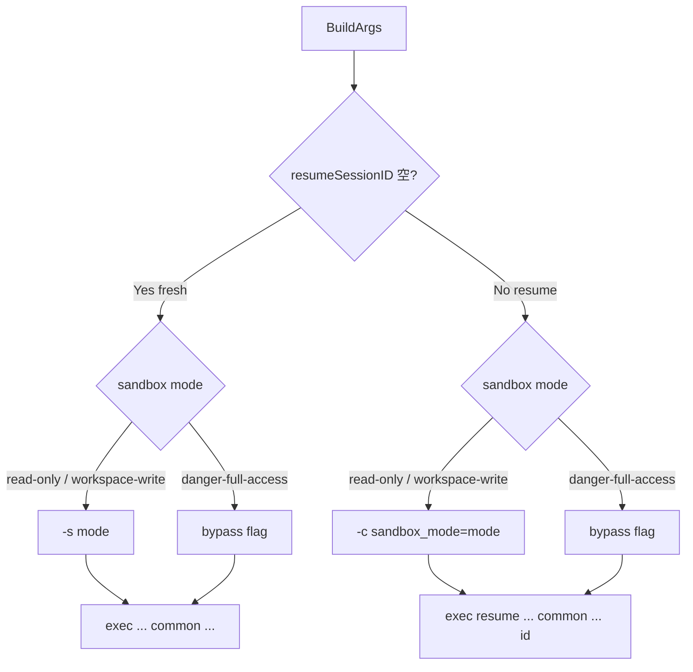

# 000: Codex resume パスの sandbox 引数修正（`-c sandbox_mode`）

> **関連 Issue**: [axsh/arctic-tern#70](https://github.com/axsh/arctic-tern/issues/70)
>
> **実装フェーズ**: Phase 1（本ブランチの **最初** に実装する）。
>
> **後続仕様**: [001-Overlay-ConfigDir-Always-Copy.md](./001-Overlay-ConfigDir-Always-Copy.md)（Issue #71）
>
> **上流**: [openai/codex#40149](https://github.com/openai/codex/issues/40149)（`codex exec resume` が `-s/--sandbox` を拒否）

## 背景 (Background)

Codex バックエンドの 2 ターン目以降は `codex exec resume` を使う。現状の `BuildArgs` は fresh / resume とも sandbox フラグを共通配列 `common` に入れ、resume 時は次の形になる。

```text
codex exec resume --json -s read-only|workspace-write <session-id> ...
```

現行 codex-cli（検証済み 0.139.0 / 0.167.0）は `resume` **後**の `-s` を clap で拒否する。

```text
error: unexpected argument '-s' found
```

その結果:

1. プロセスが exit 2 で失敗する。
2. `unexpected argument` は Tern の非リトライ針に含まれないため `Retryable` になる。
3. agentservice の self-heal が native thread id をクリアし、履歴注入つきの fresh `exec` で挽回する。

ターン自体は完了するが、毎回余分な起動コスト（約数秒）、native resume 連続性の喪失、WARN ログ（`cleared broken native thread id for self-heal` / `self-heal fresh exec without native resume`）が発生する。Eightmil など呼び出し側は argv を組み立てず Tern に依存しているため、Tern 側の修正が必要である。

上流では親 `exec` の一部フラグが `resume` 後でも通るようになったが（openai/codex#8440）、`-s/--sandbox` は含まれていない。他 integrator は resume で `-c sandbox_mode="..."` を使う回避が既にある。

### 本 Phase で決めること

| 項目 | 決定 |
| :--- | :--- |
| 変更層 | `shared/libs/go/codingagent/codex` の `BuildArgs`（必要なら sandbox ヘルパ） |
| スコープ | resume 時の sandbox 表現を CLI が受理する形に直す |
| スコープ外 | self-heal ロジック本体の削除、Claude の sandbox、Issue #71（overlay） |
| fresh exec | 既存の `-s` 互換を維持する（破壊的変更を避ける） |

---

## 要件 (Requirements)

### 必須要件 (Must)

#### R1: resume パスで `-s` / `--sandbox` を付けない

- `resumeSessionID != ""` のとき、`BuildArgs` の argv に `-s` およびその値（`read-only` / `workspace-write`）を含めない。
- `unexpected argument '-s'` による resume 起動失敗を起こさない。

#### R2: resume パスで同等の sandbox 方針を `-c sandbox_mode=...` で渡す

- `read-only` → `-c sandbox_mode="read-only"`
- `workspace-write` → `-c sandbox_mode="workspace-write"`
- 空の sandboxMode は既存どおり `EffectiveSandboxMode` により `read-only` 扱いとする。
- `-c` は resume サブコマンドが受理する既存チャネルであり、`BuildConfigOverrides` と並べて渡してよい。

#### R3: `danger-full-access` は resume でも bypass フラグを維持

- `danger-full-access` のときは既存どおり `--dangerously-bypass-approvals-and-sandbox` を使う（上流で resume 後も親フラグとして受理される）。
- このモードでは `-s` も `-c sandbox_mode=...` も付けない（現状 fresh と同じ）。

#### R4: fresh exec（非 resume）の argv 互換を維持

- `resumeSessionID == ""` のとき:
  - `read-only` / `workspace-write` → 従来どおり `-s <mode>`
  - `danger-full-access` → 従来どおり bypass フラグ
- 既存の `TestCodexBuildArgs_*`（fresh 系）が失敗しないこと。

#### R5: 単体テストで resume × sandbox の argv を固定する

- 最低限カバーするケース:
  - resume × `read-only`: `exec resume` あり、`-s` なし、`-c sandbox_mode="read-only"` あり
  - resume × `workspace-write`: 同上で `workspace-write`
  - resume × `danger-full-access`: bypass フラグあり、`-s` なし
  - fresh × `read-only` / `workspace-write`: 従来どおり `-s` あり（リグレッション）
- 既存 `TestCodexBuildArgs_ResumeUsesExecResume` は danger 専用のため、上記を追加または拡張する。

### 任意要件 (Nice to Have)

#### O1: self-heal ログの回帰観測用コメント / メトリクス

- 実装コメントまたは docs で「#70 修正後は通常の 2 ターン目で self-heal が出ない」旨を残す。
- コード変更は必須ではない。

#### O2: `IsNonRetryableError` に `unexpected argument` を追加

- 根本修正は R1/R2。補助として clap 誤設定を non-retryable にしてもよいが、本 Phase の必須ではない。

---

## 実現方針 (Implementation Approach)

### 変更ファイル（想定）

| ファイル | 変更 |
| :--- | :--- |
| `shared/libs/go/codingagent/codex/process.go` | `BuildArgs` を resume / fresh で sandbox 表現を分岐 |
| `shared/libs/go/codingagent/codex/process_test.go` | R5 の単体テスト追加・既存更新 |
| （任意）`docs/reference-manual-web-apis.md` または Codex 関連メモ | resume 時の sandbox 渡し方を一文追記 |

### BuildArgs 分岐（目標）



### 設計上の決定

1. **`-c sandbox_mode` を resume の正とする**。`-s` を `resume` より前（親 `exec`）に移す案は、clap 受理と resume ターンへの実効適用が保証されないため採用しない。
2. **fresh は `-s` のまま**。統合側の観測や既存テストとの差分を最小化し、本 Issue の症状（resume 拒否）に限定する。
3. **self-heal は残す**。本当に壊れた native thread 向けの防御として維持する。本修正後、正常な 2 ターン目では発火しないことが受け入れ条件になる。

### 受け入れ条件（Issue / Eightmil 視点）

- 同一 Codex セッションで 2 回以上 `SendMessage` したとき、通常パスで `self-heal fresh exec without native resume` / `cleared broken native thread id for self-heal` が出ない。
- リリース後に固定タグを案内できること。

---

## 検証シナリオ (Verification Scenarios)

Issue #70 および調査で確認した事実に基づく。

1. **CLI 非対称（現状の失敗形）**
   - `codex exec resume -s read-only ...` → 拒否
   - `codex exec resume -c sandbox_mode="read-only" ...` → 受理
2. **Tern 修正後の argv**
   - セッション作成（sandbox 省略 = read-only）→ メッセージ 1（fresh `exec -s read-only`）→ メッセージ 2（`exec resume` + `-c sandbox_mode="read-only"`、`-s` なし）
3. **workspace-write**
   - CreateSession で `sandbox_mode=workspace-write` → 2 ターン目も `-c sandbox_mode="workspace-write"` で起動し、self-heal しない
4. **danger-full-access**
   - resume でも bypass フラグのみ（`-s` なし）

---

## テスト項目 (Testing)

### 単体テスト

```bash
go test ./shared/libs/go/codingagent/codex/ -count=1 -run 'TestCodexBuildArgs'
```

### ビルド + 関連統合

```bash
./scripts/process/build.sh
./scripts/process/integration_test.sh --specify "TestSandboxMode"
```

Linux / Remote-SSH（Linux）の場合:

```bash
./scripts/process/build.sh --skip-etc
xvfb-run -a ./scripts/process/integration_test.sh --specify "TestSandboxMode"
```

### リグレッション（stream / resume 周辺）

```bash
./scripts/process/integration_test.sh --specify "TestStreamReconnect"
```

Linux:

```bash
xvfb-run -a ./scripts/process/integration_test.sh --specify "TestStreamReconnect"
```

### Live（任意・環境がある場合）

```bash
./scripts/process/integration_test.sh --specify "TestLiveCodex_Resume"
```

受け入れ: 2 ターン目以降のワーカーログに `self-heal fresh exec without native resume` が通常成功パスで出ないこと。

### カテゴリ実行（本 Phase 完了時）

```bash
./scripts/process/integration_test.sh --categories common,llm
```

Linux:

```bash
xvfb-run -a ./scripts/process/integration_test.sh --categories common,llm
```
