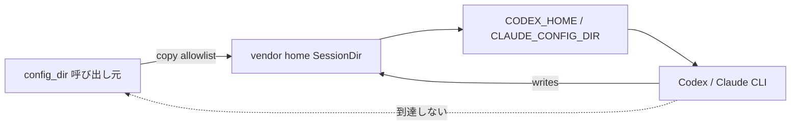

# 001: OverlayConfigDir を常時 copy に変更（symlink 書き戻し防止）

> **関連 Issue**: [axsh/arctic-tern#71](https://github.com/axsh/arctic-tern/issues/71)
>
> **実装フェーズ**: Phase 2。**先に** [000-Codex-Resume-Sandbox-Config-Override.md](./000-Codex-Resume-Sandbox-Config-Override.md)（Issue #70）を完了してから実装する。
>
> **先行仕様（設計前提）**: `prompts/phases/000-foundation/branches/feat-profiles/ideas/000-ConfigDir-Separate-From-SessionDir.md`（ソースは read-only、書き込みは session 側のみ）

## 背景 (Background)

`OverlayConfigDir` は呼び出し元の `config_dir` から allowlist エントリを vendor home（Codex の `CODEX_HOME` / Claude の `CLAUDE_CONFIG_DIR` = adapter の `SessionDir`）へ載せる。現状の `linkOrCopy` は **symlink 優先**、失敗時のみ再帰 copy である。

```text
config_dir/skills  --symlink-->  {storage_root}/.codex/skills
config_dir/config.toml --symlink--> {storage_root}/.codex/config.toml
```

symlink が成功する環境（例: Windows Developer Mode）では:

1. Codex が `config.toml` に `trust_level` を追記したり、組み込み skills を `skills/.system` に置くと、**呼び出し元の `config_dir` が書き換わる**。
2. `config_dir` が Agent から書ける場所（特に `work_dir` 配下）にあると、Agent が symlink 経由で `config.toml` を書き換え、次ターンの sandbox / writable_roots 方針を変えられる。
3. symlink が失敗する環境では copy になるため、**OS 間でセマンティクスが一致しない**。

`StorageRoot` 未指定時は `ResolveStorageRoot` により `work_dir` が既定となり、Codex home は `{work_dir}/.codex` になる。デフォルト配置がリスクを増幅する。

feat-profiles 仕様は「ソースは read-only 前提」と書いていたが、symlink 優先はその前提を壊している。Eightmil は `config_dir` / `StorageRoot` を work dir 外へ逃がす緩和済みだが、他呼び出し側のため Tern の overlay セマンティクスを安定させる必要がある。

### 本 Phase で決めること

| 項目 | 決定 |
| :--- | :--- |
| 変更層 | `shared/libs/go/codingagent/config_overlay.go`（Claude/Codex 共通） |
| 既定動作 | **常時 copy**（symlink しない） |
| スコープ外 | Issue #70、marketplace plugin 肥大化（#48）、設定 UI |
| 任意防御 | `config_dir` が `work_dir` 内なら警告（必須ではない） |

---

## 要件 (Requirements)

### 必須要件 (Must)

#### R1: `linkOrCopy`（または同等ヘルパ）を常時 copy にする

- overlay 適用時、dst は src の内容コピーとする。
- `os.Symlink` によるゼロコピー経路は使わない。
- 既存の `RemoveAll(dst)` → 配置、の流れは維持してよい（再適用で最新内容に更新する）。

#### R2: Claude / Codex 双方に同一セマンティクスを適用する

- `ApplyClaudeConfigDir` / `ApplyCodexConfigDir` は引き続き共有 `OverlayConfigDir` を呼ぶ。
- allowlist の差（Claude: `skills`, `rules`, `CLAUDE.md`, `settings.json` / Codex: `skills`, `rules`, `config.toml`, `AGENTS.md`）は変更しない。
- 保護 basename（`projects`, `sessions`, `native` 等）の非破壊ルールは維持する。

#### R3: 呼び出し元 `config_dir` への書き戻しを防ぐ

- overlay 後、dst 側ファイルへの書き込みが src（`config_dir`）の内容を変えないこと。
- 単体テストで検証する（例: dst の `config.toml` に追記 → src の内容が不変）。

#### R4: dst が symlink でないことをテストで固定する

- overlay 適用後、allowlist で配置した各 dst について `Lstat` し、symlink でないこと（通常ファイルまたはディレクトリ）を断言する。
- 再適用ケースでも同様。

#### R5: ドキュメント更新

- API / 利用者向けドキュメントに次を明記する:
  - overlay は **vendor home への copy** であり、呼び出し元 `config_dir` は入力として扱い書き戻さない。
  - 推奨: `storage_root` および `config_dir` を `work_dir` の外に置く（Agent が work tree を書ける場合の防御）。
- 更新候補: `docs/reference-manual-web-apis.md`（`config_dir` / `storage_root` 節）、必要なら `examples/config-dir-switch/README.md`。

### 任意要件 (Nice to Have)

#### O1: `config_dir` が `work_dir`（またはその配下）にある場合の警告

- CreateSession / 解決時にログ WARN を出す、またはソフト拒否する。
- 単独では Codex による書き戻し（R1 前）を防げないため、**常時 copy の代替にはならない**。
- 既存の in-repo config レイアウトを壊す可能性があるため、本 Phase では任意。入れる場合は warn のみを推奨（hard refuse は別仕様）。

#### O2: copy 戦略の設定化

- 将来サーバ設定で symlink を選べるようにする案は、feat-profiles O3 にあったが、**本 Phase では実装しない**（既定が安全であることが優先）。

---

## 実現方針 (Implementation Approach)

### 変更ファイル（想定）

| ファイル | 変更 |
| :--- | :--- |
| `shared/libs/go/codingagent/config_overlay.go` | `linkOrCopy` を copy 専用に変更、コメント更新 |
| `shared/libs/go/codingagent/config_overlay_test.go` | R3/R4 の単体テスト追加 |
| `shared/libs/go/codingagent/codex/config_overlay_test.go` | 必要なら symlink 非存在の確認を追加 |
| `shared/libs/go/codingagent/claudecode/config_overlay_test.go` | 同上 |
| `docs/reference-manual-web-apis.md` | R5 のセマンティクス追記 |

### データフロー（修正後）



### 設計上の決定

1. **常時 copy を唯一の実装にする**。条件付き symlink は複雑さと OS 差を残すため採用しない。
2. **パフォーマンスより隔離を優先する**。allowlist は数ファイル〜小さなディレクトリ想定で、起動ごとの copy コストは許容する。
3. **mid-process の src 編集は次 overlay まで反映されない**。これは copy セマンティクスの意図した結果であり、呼び出し側はセッション作成 / メッセージ前の overlay タイミングを前提とする。
4. **O1 警告は本 Phase の必須にしない**。隔離の本丸は R1。レイアウト警告はフォローアップでよい。

### 受け入れ条件（Issue 視点）

- Developer Mode 有効な Windows でも、Codex 起動後に呼び出し元 `config_dir` の `config.toml` / `skills` が Tern 起因で書き換わらない。
- Linux / macOS / Windows で overlay 結果（実体 copy）が一致する。
- 修正後のリリースタグを案内できること。

---

## 検証シナリオ (Verification Scenarios)

Issue #71 で報告された観測に対応する。

1. **書き戻し防止（単体）**
   - 一時 `config_dir` に `config.toml` / `skills` を用意 → `OverlayConfigDir` → dst を書き換え → src の内容・mtime 相当が不変
2. **非 symlink（単体）**
   - overlay 後の dst を `Lstat` し symlink でない
3. **保護エントリ**
   - session 側の `sessions` / `projects` / `native` 等が allowlist 誤指定でも消えない（既存テスト維持）
4. **再適用**
   - src を更新して再 overlay → dst 内容が更新される（copy の再適用）
5. **統合（既存 ConfigDir 系）**
   - ConfigDir 永続化・レーン分離・同一セッション再適用が壊れていないこと

---

## テスト項目 (Testing)

### 単体テスト

```bash
go test ./shared/libs/go/codingagent/ -count=1 -run 'TestOverlayConfigDir'
go test ./shared/libs/go/codingagent/codex/ -count=1 -run 'TestApplyCodexConfigDir'
go test ./shared/libs/go/codingagent/claudecode/ -count=1 -run 'TestApplyClaudeConfigDir'
```

### ビルド + ConfigDir 関連統合

```bash
./scripts/process/build.sh
./scripts/process/integration_test.sh --specify "ConfigDir"
```

Linux / Remote-SSH（Linux）の場合:

```bash
./scripts/process/build.sh --skip-etc
xvfb-run -a ./scripts/process/integration_test.sh --specify "ConfigDir"
```

### カテゴリ実行（本 Phase 完了時）

```bash
./scripts/process/integration_test.sh --categories common,llm
```

Linux:

```bash
xvfb-run -a ./scripts/process/integration_test.sh --categories common,llm
```

### 本ブランチ全体（#70 + #71）完了時の回帰

```bash
./scripts/process/integration_test.sh --categories common,llm
```

Linux:

```bash
xvfb-run -a ./scripts/process/integration_test.sh --categories common,llm
```
