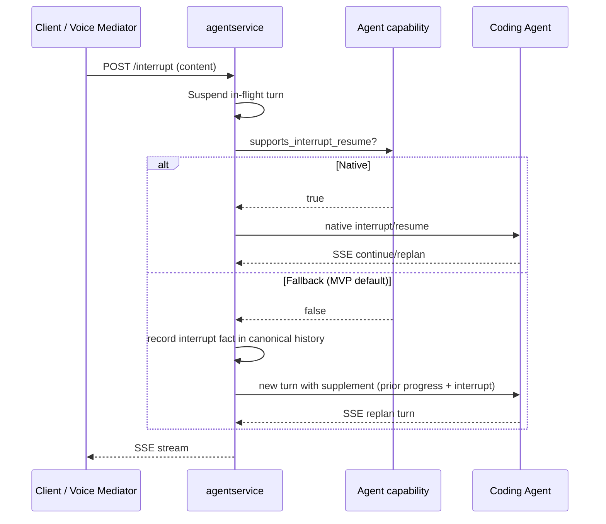

# 000: ターン割り込みと再開（Interrupt / Native resume / Fallback replan）

## 背景 (Background)

### なぜ必要か

Tern（CAWA）は Coding Agent（Claude Code / Codex / Wayfinder 等）を透過的に仲介する。現行の実行モデルは **セッションあたり同時に 1 ターン**であり、実行中に再度 `POST .../messages` すると HTTP **409 `session busy`** となる。クライアントが取れるのは概ね次のいずれかである。

- ターン完了を待つ
- `Follow` で購読だけ続ける
- `respond`（`suspended` / ask_user 待ち専用）
- `cancel`（ターン破棄・session 維持）または `terminate`（session 閉鎖）

この契約は安全性（二重実行の防止）には有効だが、**途中で方針を差し替えたい**という操作を表現できない。特に次の利用ではギャップが顕在化する。

1. **低遅延双方向音声**（Voice Mediator 経由の barge-in）: 話しながら進行中タスクを止め、指示を踏まえてやり直す／続ける
2. **テキストの mid-turn 追指示**: 長いターンの途中で「それやめ、こっちで」と差し替える

音声仲介（Voice Mediator / 方式 B）は別仕様とする。本仕様はその前提能力として、**CAWA 上の割り込み意味論**を先に定義する。調査上の順序としても、割り込みが無いと音声レイヤは「通話は滑らかだがコーディング中の舵取りは粗い」状態に留まる。

関連調査（ローカル Artifact、リポジトリ非コミット想定）: `tmp/investigations/015-Tern-Realtime-Voice-Mediation.md`

### 現状の課題

| 観点 | 現状 |
| :--- | :--- |
| busy 中の追入力 | 409。割り込み意図を運べない |
| `cancel` | 停止はできるが、中断事実・途中成果を踏まえた「継続／再計画」の公式経路が無い |
| `respond` | ask_user 専用。一般 barge-in ではない |
| Agent 差 | 真の中断再開 API を全 Agent が持つ保証はない |
| ロードマップ | Phase 2 に Interactive execution / Multimodal Voice があるが、割り込み意味論の仕様は未整備 |

### スコープ

| 対象 | 内容 |
| :--- | :--- |
| 対象 | CAWA の割り込み API、Native resume 優先と Fallback replan の二層、正本 history への中断事実、client/v1、agentservice、Agent capability 宣言口 |
| 非対象 | Voice Mediator / WebRTC / Realtime 音声そのもの |
| 非対象 | ブラウザ Web Speech 等のテキスト代替入力 |
| 非対象 | 各 Agent の Native resume 本実装（能力口と Fallback 既定まで。Native 配線は後続） |
| 非対象 | 409 の完全廃止（通常の二重 `messages` は引き続き拒否） |

### 仮の決定・先送り（backlog）

- backlog:acf44bcc-f2f9-48df-8969-c9e975f1aeb2 — 公開 API 名を仮に `interrupt` とする
- backlog:f627eae3-e0a1-4923-9ddc-cbc531851166 — MVP の停止粒度は即時停止（cancel 相当）を既定とする
- backlog:314b541f-199c-496e-a201-c2a5a0e9af38 — Agent 別 Native resume の実装時期は先送り（capability 口のみ）

---

## 要件 (Requirements)

### 必須要件 (Must)

#### M1. 統一割り込みエントリ（公開契約）

- busy（インフライト実行あり）なセッションに対し、クライアントは **単一の割り込み API** で次を依頼できる。
  - 仮パス: `POST /api/v1/sessions/:id/interrupt`（backlog:acf44bcc-f2f9-48df-8969-c9e975f1aeb2）
  - 仮 client: `Session.Interrupt(ctx, req)`
- リクエストは少なくとも次を含む。
  - `content`（必須）: 割り込み発話／追指示のテキスト（将来の multimodal 拡張は任意要件）
  - 任意: `correlation_id`（既存 messages と同様の相関）
- インフライトが無いセッションへの interrupt は **409**（または明確なエラー）。通常の新ターンは従来どおり `messages` を使う。
- idle への「ただのメッセージ」を interrupt に統合しない（責務分離）。

#### M2. 意味論: Suspend → Inject → Reconcile → Resume/Replan

割り込み処理は次の概念ステップを踏む（アプリから見えるのは一つの API）。

1. **Suspend**: 進行中ターンを停止する（MVP 既定は即時停止。backlog:f627eae3-e0a1-4923-9ddc-cbc531851166）
2. **Inject**: 割り込み内容をセッション文脈に載せる
3. **Reconcile**: Native または Fallback が、継続可能な作業と再計画が必要な作業を切り分ける
4. **Resume / Replan**: 継続または再計画の実行を開始し、結果を SSE で返す

`cancel` 単体とは区別する。`cancel` は「止めて終わり（次はクライアントが普通に messages）」であり、interrupt は「止めたうえで指示を踏まえて続ける／やり直す」である。

#### M3. Native resume 優先、Fallback replan 既定

- Coding Agent が **interrupt resume 能力**を持つ場合、Tern は **Agent 内部の真の resume** を優先して使う。
- 能力が無い、失敗した、未配線の場合は **Fallback replan** に落とす。
- MVP では全 Agent の既定実装を Fallback とする（Native 本実装は後続。backlog:314b541f-199c-496e-a201-c2a5a0e9af38）。
- 設計上、Native を第一級・Fallback を劣化経路として固定し、後から Adapter 差し替えで昇格できるようにする。

#### M4. Fallback replan の振る舞い

Fallback は少なくとも次を行う。

1. インフライト実行を停止する（既存 `CancelTurn` 相当の停止セマンティクスを再利用してよい。session を `closed` にしない）
2. 正本（canonical history）に **中断レコード**を残す。含める情報の例:
   - 中断された `turn_id`
   - 中断理由（interrupt）
   - 割り込み `content`
   - 可能なら、中断までに観測できた進捗要約（SSE の text / progress / 完了済み tool の要約。完全性はベストエフォート）
3. **同一 session id** で新しいターンを開始し、Agent に「中断事実と途中成果を踏まえ、継続できることは継続し、必要なことは計画しなおせ」と分かるプロンプト／supplement を渡す
4. そのターンの SSE を interrupt 呼び出しの応答ストリームとして返す（`Accept: text/event-stream`）。クライアントが Follow で拾う経路も許容するが、少なくとも一方を仕様で固定する

#### M5. Capability 宣言口

- Agent（またはセッション）が interrupt resume 対応かどうかを機械可読に示す口を用意する。
  - 仮名: `supports_interrupt_resume`（bool）
  - 公開場所の候補: `GET /api/v1/agents` の拡張、または GetSession のフィールド。実装計画で一方に決める
- MVP では全 Agent が `false`（または未設定＝false）でよい。`true` のときだけ Native 経路を選ぶ。

#### M6. 既存契約との共存

- 通常の二重 `messages` は引き続き **409 session busy**（hint を interrupt を含むよう更新してよい）
- `respond` は `suspended`（ask_user）専用のまま。interrupt で置換しない
- `terminate` は session 閉鎖のまま。interrupt は session を閉じない
- `cancel` は残す。interrupt 未使用の単純中断ニーズ向け
- Wayfinder / Codex / Claude で Fallback が動くこと（Native 非依存）を必須とする。特定 Agent だけ成功、は不可

#### M7. ドキュメントと client

- `docs/reference-manual-web-apis.md` に interrupt を追記する
- `client/v1` に Interrupt API を追加する
- busy hint / examples に「追指示は interrupt」を短く示す

#### M8. 観測可能性

- interrupt 採用経路（`native` / `fallback`）をログおよび／または SSE system／progress イベントでクライアントが区別できるようにする（少なくともサーバログは必須、SSE 露出は推奨）

### 任意要件 (Nice to Have)

#### N1. 構造化進捗の utterance hint

- 後続の音声読み上げや Reconcile 精度のため、`progress` に短い phase / hint を載せる拡張（本仕様のブロッカーにしない）

#### N2. interrupt リクエストの multimodal content

- 画像付き割り込み。MVP はテキストのみでよい

#### N3. キューイング

- interrupt 連続投に対するサーバ側キュー。MVP は「一度に一つの interrupt 処理」、重複は 409 でよい

---

## 実現方針 (Implementation Approach)

### 設計方針



1. **公開面は一つ、内部は二経路**（画像の `SupportsMultimodal` と同型）
2. **実行権威は常に Coding Agent**。Tern は停止・事実の永続化・経路選択・プロンプト supplement を担う
3. **Fallback を恥ずかしい例外にしない**。現時点の既定実装として正式に扱う
4. **Voice は本仕様の外**。Voice Mediator は後続仕様で本 API を叩く

### 主要コンポーネント（想定）

| 箇所 | 役割 |
| :--- | :--- |
| `agentservice` | `handleInterrupt`、busy 中の受理、経路選択、SSE 応答 |
| `exec_registry` | Suspend 時の実行解放。cancel との共通化／差分を明確化 |
| `codingagent` | capability インタフェース（仮: `InterruptResumer` または Agents 一覧のフラグ） |
| canonical / ingest | 中断レコードの正本追記 |
| `client/v1` | `Interrupt` |
| docs | Web API リファレンス |

### MVP の Fallback 手順（詳細）

1. `execRegistry` に active が無ければ 409
2. 進行中 SSE 購読者へ中断を通知し、実行コンテキストを cancel（既存 cancel 経路の再利用を優先）
3. session を `closed` にしない。必要なら一時 status を定義するか、即座に次ターンで `active` に戻す（実装計画で選ぶ）
4. history に interrupt 事実を Append（user 由来の割り込み＋ system/assistant 側の中断要約）
5. `runTurn` 相当で新ターン開始。supplement または先頭メッセージに中断コンテキストを含める
6. 応答 SSE をクライアントへ返す

### Native 経路（将来）

- `supports_interrupt_resume == true` の Adapter のみ実装
- Tern は停止と注入を Adapter メソッドに委譲し、正本への事実記録は共通で行う
- 失敗時は同一リクエスト内で Fallback に落とすか、明示エラーにするかを Adapter 仕様で定義（後続 idea）

### 既存 cancel との関係

| API | 止める | 指示を注入 | 自動で次実行 | session |
| :--- | :---: | :---: | :---: | :--- |
| `cancel` | Yes | No | No | 維持 |
| `interrupt` | Yes | Yes | Yes（resume/replan） | 維持 |
| `terminate` | Yes | No | No | closed |
| `respond` | No（再開） | Yes（ask_user 回答） | 同一ターン継続 | 維持 |

---

## 検証シナリオ (Verification Scenarios)

1. **busy 中の通常 messages は依然 409**  
   (1) セッションを作り長めのターンを開始する。(2) 完了前に `POST .../messages` する。(3) 409 `session busy` であること。(4) hint に interrupt（または確定した動詞）が含まれること。

2. **Fallback interrupt のハッピーパス**  
   (1) mock または実 Agent で長時間ターンを開始する。(2) busy 中に `POST .../interrupt` で「方針変更: ファイル X だけ作れ」等を送る。(3) 旧ターンが停止し、session が `closed` でない。(4) 新しい実行が始まり SSE で進捗／結果が流れる。(5) 正本 history に割り込み内容と中断の痕跡がある。(6) 経路が fallback であることがログ（または SSE）で分かる。

3. **idle への interrupt は拒否**  
   (1) ターンが無い session に interrupt する。(2) 409（または仕様で決めたエラー）で、誤って新ターンが始まらない。

4. **cancel との使い分け**  
   (1) busy 中に `cancel` する。(2) 停止し session 維持、自動の再計画ターンは始まらない。(3) その後クライアントが `messages` で次ターンを送れる（既存契約の回帰）。

5. **連続 interrupt**  
   (1) interrupt 処理中に再度 interrupt する。(2) MVP では 409 等で拒否し、二重実行しない。

6. **capability が false のとき Native を呼ばない**  
   (1) 全 Agent 既定 false。(2) interrupt しても Native 用フックが呼ばれず Fallback のみ。

7.（任意・後続）**capability true の stub Agent**  
   (1) テスト用 Agent が Native 成功を返す。(2) 経路が native と記録される。(3) Native がエラーを返したら Fallback または明示失敗（後続仕様の決定に従う）。

---

## テスト項目 (Testing for the Requirements)

### 要件と検証の対応

| 要件 | 検証 |
| :--- | :--- |
| M1 統一 API | HTTP／client 単体: パス・ボディ・idle 409 |
| M2 / M4 Fallback | agentservice 単体（mock agent）+ history 断言 |
| M3 / M5 capability | 単体: false 既定、true stub で経路分岐（stub は本仕様内で最小） |
| M6 共存 | 409 messages 回帰、cancel / terminate / respond 回帰 |
| M7 docs/client | client 単体テスト、ドキュメントはレビュー |
| M8 経路観測 | ログまたは SSE フィールドのテスト |

### ビルド・自動化コマンド

1. ビルド＋単体テスト:

```bash
./scripts/process/build.sh
```

（Linux / Remote-SSH Linux では `./scripts/process/build.sh --skip-etc`）

2. 割り込み／cancel／busy 関連の統合テスト（実装後のテスト名に合わせて `--specify` を調整）:

```bash
./scripts/process/integration_test.sh --specify 'Interrupt|Cancel|SessionBusy|Respond'
```

3. セッション Follow／recover 回帰（busy・cancel 近傍の非回帰）:

```bash
./scripts/process/integration_test.sh --specify 'Follow|Cancel|SessionRecover|ToolHeartbeat'
```

4. ライブ E2E（実 CLI が使える環境。必須ゲートは実装計画で Codex 中心とし、名前は実装時に確定）:

```bash
./scripts/process/integration_test.sh --specify 'LiveTurnInterrupt_|LiveTurnCancel_'
```

本リポジトリの `integration_test.sh` はカテゴリ分割より `--specify` 絞り込みが主である。オプション無しの全量実行は Nightly 等に留め、開発中は上記を用いる。

---

## 非目標・後続

- Voice Mediator（方式 B）の仕様・実装 → 本仕様マージ後に別 idea
- 各本番 Agent の Native resume 本配線 → backlog:314b541f-199c-496e-a201-c2a5a0e9af38
- soft interrupt（ツール境界待ち）の高度化 → backlog:f627eae3-e0a1-4923-9ddc-cbc531851166 の見直し後

---

## 参考

- `docs/reference-manual-web-apis.md`（messages / events / cancel / respond）
- `docs/roadmap.md`（Interactive agent execution / Multimodal Voice）
- `docs/use-cases.md`（埋め込み・オンデマンド・Agent 交換可能性）
- `shared/libs/go/agentservice/exec_registry.go`
- `prompts/phases/001-phase02/branches/feat-tool-heartbeat-and-turn-cancel/ideas/000-Live-E2E-Tool-Heartbeat-And-Turn-Cancel.md`
