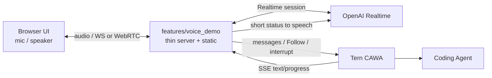

# 001: 音声対話デモ Web アプリ（features/voice_demo）

## 背景 (Background)

### なぜ必要か

ターン割り込み（`POST .../interrupt`）は Part 1 / Part 2 で CAWA 上に実装済みである。一方、割り込みの本来の動機のひとつは **低遅延双方向音声での barge-in**（話しながら進行中タスクを止め、指示を踏まえてやり直す／続ける）である。

調査 `tmp/investigations/015-Tern-Realtime-Voice-Mediation.md` では、本番向けに方式 B（Voice Mediator）を推奨しつつ、会話レイヤと実行レイヤを分けることを求めている。本仕様はその本番 Mediator そのものではなく、**人がブラウザで話しかけて「Coding Agent と声でやりとりでき、会話によるインタラプトが効く」ことを確かめられる最小デモ**を置く。

コードは製品コアというより **技術的な Example** である。綺麗なモジュール分割より、処理の流れがコメントで追える平易な実装を優先する。

### 現状の課題

| 観点 | 現状 |
| :--- | :--- |
| CAWA 割り込み | 実装済み。テキスト／HTTP では確認できる |
| 音声経路 | リポジトリに Realtime 双方向デモが無い |
| 体験確認 | 「声で途中から指示を差し替えられるか」を人が一度見られる入口が無い |
| 本番 Voice Mediator | 未仕様（本デモの後続。backlog:9e1a6c40-92ce-40bc-980a-f36e8b7d7b26） |

### スコープ

| 対象 | 内容 |
| :--- | :--- |
| 対象 | `features/voice_demo` に置くシンプルな Web デモ（ブラウザ UI + 薄いサーバ） |
| 対象 | Realtime 会話レイヤと CAWA（Coding Agent）の仲介（messages / Follow / interrupt） |
| 対象 | busy 中の追発話 → `interrupt` による会話インタラプトの確認 |
| 対象 | コメント多め・平易な Example 実装（過度な抽象化を避ける） |
| 非対象 | 本番 Voice Mediator 製品 API・`tern-voice` バイナリ・ベンダー交換可能なアダプタ層 |
| 非対象 | CAWA 本体への WebRTC 内蔵、Coding Agent への Realtime 直結 |
| 非対象 | ブラウザ Web Speech のみのテキスト代替入力を「本デモの主経路」にすること |
| 非対象 | 各 Agent の Native resume 本配線（既存 Fallback interrupt で足りる） |
| 非対象 | 綺麗な Clean Architecture / 多層 DI / 過度なパッケージ分割 |

### 仮の決定・先送り（backlog）

- backlog:3a7b6be4-2d71-41c4-bbc6-346235b5b2d4 — デモ初版の Realtime ベンダーを OpenAI Realtime に仮固定
- backlog:9e1a6c40-92ce-40bc-980a-f36e8b7d7b26 — `features/voice_demo` はデモ専用。本番 Voice Mediator は別 idea
- backlog:1281294e-21e2-4637-8e4a-7a8239939b72 — busy 中の追発話は `interrupt`、idle は `messages`

前提能力: [000-Turn-Interrupt-And-Resume.md](prompts/phases/001-phase02/branches/feat-turn-interrupt-resume/ideas/000-Turn-Interrupt-And-Resume.md)

---

## 要件 (Requirements)

### 必須要件 (Must)

#### M1. 配置と起動形態

- 新規ディレクトリ `features/voice_demo` にデモを置く（既存 `features/` の兄弟モジュール）。
- ブラウザで開ける **シンプルな Web アプリ**とする（専用ネイティブ UI や IDE 拡張は作らない）。
- 起動はドキュメント化された少数のコマンドで足りること（例: デモ用 Go バイナリ／`go run` で静的ファイルと API を配信し、既存の Tern／CAWA に接続する）。
- Tern／CAWA 本体の契約を壊さない。デモは **client として CAWA を叩く**（Agent 直結禁止）。

#### M2. 低遅延双方向音声が「動いている」ことが分かること

- ユーザーがマイクで話し、エージェント側の応答が音声（または Realtime 会話チャネル上の発話）として返ること。
- 「低遅延」の厳密な数値 SLA はデモでは定めない。目安として、会話ターンの往復がコーディング実行の完了を待たずに聞こえること（会話レイヤと実行レイヤが分離していること）。
- 画面上に、少なくとも次が見えること。
  - 通話／セッションの開始・終了
  - ユーザー発話の書き起こし（またはそれに相当するテキスト）
  - Coding Agent 側の進捗の短い要約（SSE 全文の読み上げはしない）
  - いま CAWA セッションが idle か busy（実行中）か

#### M3. 会話によるインタラプト（本デモの主目的）

- Coding Agent のターン実行中（busy）にユーザーが追発話したら、デモは **`POST /api/v1/sessions/:id/interrupt`**（client `Session.Interrupt`）を使う（backlog:1281294e-21e2-4637-8e4a-7a8239939b72）。
- `cancel` してから `messages` し直す経路を、デモの既定 barge-in にしてはならない。
- idle 時の発話は通常の `messages`（新ターン）とする。interrupt に統合しない（000 仕様の責務分離を踏襲）。
- 人がデモを操作したとき、少なくとも次が観察できること。
  1. 長い作業を音声で依頼する
  2. 実行中に方針変更を声で言う
  3. 旧ターンが止まり、新しい指示を踏まえた実行が続く（または Fallback replan が走る）
  4. 画面またはログで `interrupt` 経路（例: SSE の `interrupt_mode`、デモ UI の状態表示）が分かる

#### M4. Example としての実装スタイル

- **平易さ優先**: ファイル数・パッケージ数を抑え、メインの処理フローが上から下へ読めること。
- **コメント多め**: 「なぜこの CAWA API を呼ぶか」「busy のときだけ interrupt する理由」「Realtime と CAWA の役割分担」を、コード中の日本語または英語コメントで説明する（チャットや README だけに逃がさない）。
- **過度な抽象化をしない**: インタフェースだらけの DI、早すぎるベンダーアダプタ層、本番級の設定フレームワークは入れない。
- README に「これは Example／デモであり本番 Voice Mediator ではない」と明記する（backlog:9e1a6c40-92ce-40bc-980a-f36e8b7d7b26）。

#### M5. 設定と秘密情報

- OpenAI（Realtime）および Tern／CAWA 接続先は、環境変数またはローカル設定で渡す。リポジトリに API キーをコミットしない。
- デモ起動に必要な前提（鍵、Tern の URL、使う Agent 名）を README に書く。

#### M6. 自動化できる回帰

- Realtime 実通話に依存しない範囲で、次を自動テストする。
  - idle 発話 → `messages` を呼ぶこと
  - busy 発話 → `interrupt` を呼ぶこと（`cancel` しないこと）
  - 進捗 SSE を短い要約テキストに落とす（全文ダンプしない）ヘルパがあれば、その単体テスト
- 実マイク／実 Realtime を要する確認は手動シナリオとしつつ、自動テストをゼロにしてはならない。

### 任意要件 (Should / Nice)

#### S1. 埋め込み Tern

- デモプロセス内で Tern を起動するモードがあると便利だが、必須ではない。外部で起動した Tern の URL に接続できれば足りる。

#### S2. 英語／日本語の発話

- UI と Realtime の言語設定を切り替えられるとよい。初版は一言語固定でもよい。

#### S3. デモ用の長い作業シナリオ

- 「時間がかかる作業」を再現しやすい固定プロンプト（例: スリープを含むツール呼び出しを依頼する文言）を UI または README に用意する。

---

## 実現方針 (Implementation Approach)

### 全体像

調査 015 の方式 B を **デモ用に縮小**した配置とする。会話は Realtime、実行権威は CAWA。



### 主要コンポーネント（意図的に薄く）

| 部品 | 役割 |
| :--- | :--- |
| 静的フロント | 開始／終了ボタン、書き起こし表示、busy／idle、短い進捗 |
| デモサーバ | ephemeral 資格情報または Realtime 橋渡し、CAWA client 呼び出し、ポリシー分岐 |
| ポリシー（同一ファイルでも可） | idle → messages、busy → interrupt |
| 進捗アダプタ | SSE を短い一文に要約して Realtime／UI へ |

ファイル分割の目安（強制ではない）:

- `main.go` — 起動、フラグ、ルーティング
- `cawa.go` または同等 — session 作成、messages、Follow、interrupt
- `realtime.go` または同等 — OpenAI Realtime との接続
- `static/` — HTML / CSS / JS（フレームワーク必須にしない）
- `README.md` — 起動手順と手動シナリオ

実装スタイルの指針（M4）:

1. 「きれいな層」より「この関数が何をしているか」がコメントで分かること
2. 本番向けのパッケージ境界を先に切らない（後で本番 Mediator を別 idea で起こす）
3. `client/v1` を優先して使い、HTTP を手組み立てしすぎない（ただし Example として手組み立てを残すなら、その理由をコメントする）

### CAWA 操作ポリシー

| 会話イベント | CAWA 操作 |
| :--- | :--- |
| 通話開始 | 必要なら `CreateSession`（Agent 名は設定。既定は既存 Agent のいずれか） |
| idle でユーザー発話が確定 | `messages`（新ターン）+ Follow |
| busy でユーザー発話が確定（barge-in） | `interrupt`（content = 書き起こしテキスト） |
| ユーザーが明示的に中止だけしたい | デモ UI に cancel を置いてもよいが、**barge-in の既定にはしない** |
| 通話終了 | Realtime 切断。CAWA session は terminate するか維持するかを README で明示（初版は terminate で単純化してよい） |

### Realtime ベンダー

初版は OpenAI Realtime 固定（backlog:3a7b6be4-2d71-41c4-bbc6-346235b5b2d4）。ベンダー抽象は作らない。

### 設計上の重要な決定

1. **デモ専用**であり、CAWA コアや `shared/libs` の契約を音声向けに拡張しない（audio ContentPart 追加も本仕様ではしない）。
2. **実行権威は CAWA のみ**。Realtime の tool から Agent CLI に直接行かない。
3. **SSE 全文 TTS は禁止**（調査 015 の失敗しやすい設計）。短い状態文のみ。
4. **Example 品質**を製品品質より優先する（M4）。

---

## 検証シナリオ (Verification Scenarios)

1. **通話の基本往復**  
   (1) デモを起動し、ブラウザで通話を開始する。(2) 「自己紹介して」など短い依頼を話す。(3) 書き起こしが表示され、音声または画面で応答が返る。(4) コーディング実行が不要な相槌であっても、Realtime 側の応答がコーディング完了を待たずに聞こえる（レイヤ分離の感触）。

2. **idle 発話が messages になる**  
   (1) セッションが idle の状態で、簡単なコーディング依頼を話す（例: 作業ディレクトリに短いファイルを1つ作る）。(2) デモが `messages` を呼び、ターンが開始する。(3) 画面に busy と短い進捗が出る。(4) 完了後に idle に戻る。

3. **busy 中の会話インタラプト（主シナリオ）**  
   (1) 「しばらく時間がかかる作業」を音声で依頼し、busy にする（デモ用の長い作業文言でもよい）。(2) 実行中に「やっぱりやめて、別のファイル Y だけ作って」と話す。(3) デモが `interrupt` を呼び、`cancel`→`messages` ではない。(4) 旧ターンが止まり、新しい指示を踏まえた実行が続く。(5) UI またはログで interrupt 経路（`interrupt_mode` やデモの状態ラベル）が分かる。(6) セッションが不用意に `closed` になっていない。

4. **SSE を読み上げすぎない**  
   (1) ツール実行が多いターンを走らせる。(2) 音声側にコード全文や長いログがダンプされない。(3) 短い進捗・状態のみが読み上げまたは表示される。

5. **鍵無しでは安全に失敗する**  
   (1) Realtime 用 API キーを外して起動または通話開始する。(2) キーがリポジトリに無いこと、エラーが分かりやすいことを確認する。

6. **Example としての読みやすさ（レビュー）**  
   (1) `features/voice_demo` の主要ファイルを上から読む。(2) barge-in → interrupt の分岐に説明コメントがある。(3) 過剰なインタフェース階層が無い。

---

## テスト項目 (Testing for the Requirements)

### 要件と検証の対応

| 要件 | 検証 |
| :--- | :--- |
| M1 配置・CAWA client | ビルドで `features/voice_demo` が通る。接続先設定のスモーク |
| M2 双方向音声 | 手動シナリオ 1（実鍵）。自動は Realtime をモックした「発話確定イベント → UI/状態更新」で近似してよい |
| M3 会話インタラプト | **自動**: busy/idle ポリシーの単体または統合（messages vs interrupt の呼び出し断言）。**手動**: シナリオ 3 |
| M4 Example スタイル | レビュー（シナリオ 6）。自動テスト対象外 |
| M5 秘密情報 | キーをコミットしていないこと（リポジトリ検査）。欠落時のエラーパス |
| M6 自動回帰 | 下記コマンド |

### ビルド・自動化コマンド

1. ビルド＋単体テスト:

```bash
./scripts/process/build.sh
```

（Linux / Remote-SSH Linux では `./scripts/process/build.sh --skip-etc`）

2. voice_demo パッケージの単体（実装後のテスト名に合わせて調整）:

```bash
go test ./features/voice_demo/... -count=1
```

3. CAWA 割り込み近傍の回帰（デモが依存する既存契約）:

```bash
./scripts/process/integration_test.sh --specify 'TestTurnInterrupt_|Interrupt'
```

4. （任意・鍵がある環境）デモのライブ確認は手動シナリオ 1・3 を README の手順で実施する。オプション無しの `integration_test.sh` 全量は Nightly 等に留め、開発中は上記を用いる。

ポリシー自動テストで最低限見ること:

- 偽の「ユーザー発話確定」入力に対し、idle なら messages 相当、busy なら interrupt 相当が一度呼ばれる
- barge-in 経路で cancel が呼ばれない

---

## 非目標・後続

- 本番 Voice Mediator（方式 B の製品化、ベンダーアダプタ、公式 Voice session API）→ backlog:9e1a6c40-92ce-40bc-980a-f36e8b7d7b26 の確定後に別 idea
- Agent 別 Native resume 本配線 → backlog:314b541f-199c-496e-a201-c2a5a0e9af38
- soft interrupt（ツール境界待ち）の高度化
- ContentPart `audio` や CAWA 内蔵 WebRTC

---

## 参考

- [000-Turn-Interrupt-And-Resume.md](prompts/phases/001-phase02/branches/feat-turn-interrupt-resume/ideas/000-Turn-Interrupt-And-Resume.md)
- `tmp/investigations/015-Tern-Realtime-Voice-Mediation.md`（ローカル調査 Artifact）
- `docs/roadmap.md`（Multimodal Voice support）
- `docs/use-cases.md`（埋め込み・オンデマンド・Agent 交換可能性）
- `client/v1`（Session.Interrupt / messages / Follow）
- `features/README.md`
