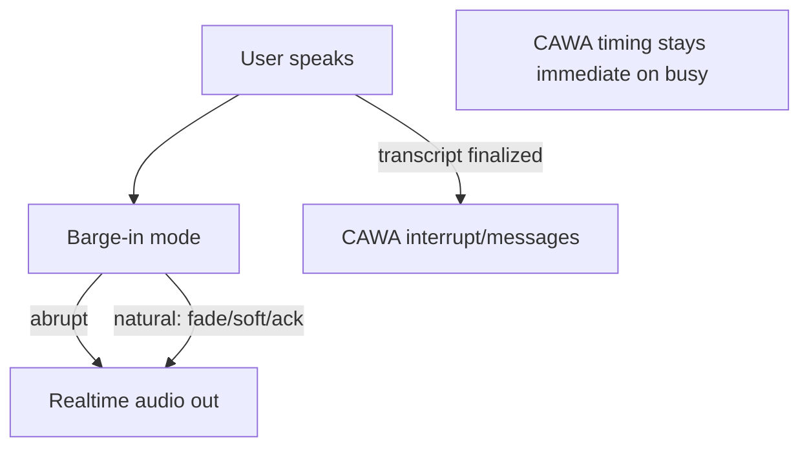

# 002: voice_demo の自然な barge-in（発話打ち切りの緩和）

## 背景 (Background)

### なぜ必要か

`features/voice_demo`（[001-Voice-Demo-Web-App.md](prompts/phases/001-phase02/branches/feat-turn-interrupt-resume/ideas/001-Voice-Demo-Web-App.md)）により、busy 中の追発話が CAWA `interrupt` に繋がること、および OpenAI Realtime による双方向音声は確認できる。一方、実操作では **ユーザーが話し始めるとアシスタント側の発話が直ちに打ち切られ、不自然**に聞こえる。

これは CAWA の即時停止（割り込み MVP）とは別に、**Realtime 会話レイヤの既定 barge-in** が大きく効いている。デモの目的は「interrupt が効くこと」に加えて、**Example の範囲で自然さを考慮できること**を示せる必要がある。本番 Voice Mediator や CAWA soft interrupt（ツール境界待ち）に進む前に、会話UX側のレバーをデモに明示する。

### 現状の課題

| 観点 | 現状 |
| :--- | :--- |
| CAWA | busy → `interrupt` は実装済み。実行の舵取りは満たす |
| Realtime 発話 | ユーザー発話開始でアシスタント音声が即切断されやすい |
| 説明力 | 「不自然だが仕様」としか言えず、自然さの選択肢がコードに無い |
| 比較 | abrupt と natural を並べて聞き比べる口が無い |

### スコープ

| 対象 | 内容 |
| :--- | :--- |
| 対象 | `features/voice_demo` 内の Realtime 発話停止ポリシーと、それに付随する UI／コメント／README |
| 対象 | abrupt / natural の比較モード（自然さを考慮できることの提示） |
| 対象 | CAWA `interrupt` 経路の維持（001 の M3 を壊さない） |
| 非対象 | CAWA 本体の soft interrupt（ツール完了待ち）。000 仕様・backlog:f627eae3-e0a1-4923-9ddc-cbc531851166 |
| 非対象 | 本番 Voice Mediator／ベンダー抽象（backlog:9e1a6c40-92ce-40bc-980a-f36e8b7d7b26） |
| 非対象 | 「人間と同じ自然さ」の定量保証や、長文 TTS の完全言い切り保証 |

### 仮の決定・先送り（backlog）

- backlog:e6861c32-96d0-4b5f-b426-7f9dd07d79c7 — CAWA は即 `interrupt`、Realtime は自然停止ポリシー（二層）
- backlog:76c13e06-3999-469d-afe6-6e54aa761635 — UI で abrupt / natural 切替。既定は natural

前提: [001-Voice-Demo-Web-App.md](prompts/phases/001-phase02/branches/feat-turn-interrupt-resume/ideas/001-Voice-Demo-Web-App.md)、[000-Turn-Interrupt-And-Resume.md](prompts/phases/001-phase02/branches/feat-turn-interrupt-resume/ideas/000-Turn-Interrupt-And-Resume.md)

---

## 要件 (Requirements)

### 必須要件 (Must)

#### M1. 二層の役割をデモで明示する

- **実行層（CAWA）**: busy 中の確定ユーザー発話は、従来どおり **即 `Session.Interrupt`** する（001 の M3、backlog:1281294e-21e2-4637-8e4a-7a8239939b72）。自然さのために CAWA interrupt を遅延させない（仮決定 backlog:e6861c32-96d0-4b5f-b426-7f9dd07d79c7）。
- **会話層（Realtime）**: アシスタント発話の止め方をポリシー化し、「即切断」以外を選べるようにする。
- コードコメントと README に、上記二層の分担を英語または日本語で書く（Example スタイル維持）。

#### M2. natural モード（既定）

natural モードでは、少なくとも次を満たすこと。

1. **ユーザーが話し始めても、アシスタント音声を無音でブツ切りしない**ことを目指す。具体手段は次のいずれか、または組み合わせでよい（実装計画で1つ以上を選ぶ）。
   - Realtime の turn detection / `interrupt_response` 相当を緩め、再生中応答の即キャンセルを抑える
   - ブラウザ側で再生オーディオを短いフェードアウトしてから止める
   - 割り込み検知後、短い Ack 発話（例: 「了解、切り替えます」）を挟んでから通常応答へ移る
2. ユーザー発話の書き起こし確定後、CAWA への `messages` / `interrupt` 呼び出しは 001 と同じポリシーで行う。
3. UI またはログに、いま natural であることと、適用した停止手段のラベル（例: `fade` / `soft_vad` / `ack`）が見えること。

#### M3. abrupt モード（比較用）

- 現行に近い **即切断** の聞こえ方を再現できるモードを残す（backlog:76c13e06-3999-469d-afe6-6e54aa761635）。
- natural と切り替え可能であること（通話開始前、または通話中の明示トグル）。
- 既定は **natural**。abrupt は「以前の聞こえ方／対比」用と README に書く。

#### M4. CAWA interrupt の観測性を維持する

- natural にしても、busy 中追発話で `last_action=interrupt`（または同等）が画面／API で分かること。
- abrupt / natural のどちらでも、barge-in の既定経路に `cancel`→`messages` を使わないこと。

#### M5. Example としての読みやすさ

- 001 の M4 を踏襲する（コメント多め、過度な抽象化禁止）。
- 「なぜ CAWA は即 interrupt で、声だけ自然に止めるのか」をコードコメントで説明する。

#### M6. 自動化

- Realtime 実マイクに依存しない範囲で、次を自動テストする。
  - モード設定（natural / abrupt）がサーバまたはクライアントのポリシー関数に反映されること
  - natural 用の停止ヘルパ（フェード時間、Ack 文言、VAD フラグなど）が期待どおりのパラメータを返すこと
  - busy → interrupt / idle → messages の分岐がモード切替後も壊れていないこと（001 の回帰）
- 聞こえ方そのものの手動確認は残してよいが、自動テストをゼロにしてはならない。

### 任意要件 (Should / Nice)

#### S1. フェード時間の調整

- natural のフェード ms をクエリや簡易 UI で変えられるとよい。無くても固定値で可。

#### S2. Ack の有無

- Ack 発話は natural のオプションでもよい。必須手段は M2 のリストから実装時に選ぶ。

---

## 実現方針 (Implementation Approach)

### 設計原則



1. **実行の正しさ**と**聞こえの自然さ**を同じノブに載せない。
2. 自然さは主に Realtime／ブラウザ再生側で示す。CAWA soft interrupt は別仕様。
3. 比較モードで「考慮できること」をレビューアが耳で確認できるようにする。

### 主要変更箇所（想定）

| 箇所 | 役割 |
| :--- | :--- |
| `features/voice_demo/static/app.js` | モード切替、フェード／再生制御、Realtime イベント解釈 |
| `features/voice_demo/realtime.go` | client_secrets の session に turn_detection / interrupt 関連設定をモード別に載せる（必要な場合） |
| `features/voice_demo/static/index.html` | abrupt / natural トグル（`data-testid` 付き） |
| `features/voice_demo/README.md` | 聞き比べ手順、二層の説明 |
| 小さな `bargein_policy.go` または JS 内関数 | モード → パラメータの表（単体テスト容易なら Go 側に寄せてよい） |

### モード定義（仮）

| モード | Realtime / 再生 | CAWA（busy 時） |
| :--- | :--- | :--- |
| `natural`（既定） | 即無音切断を避け、M2 の手段を適用 | 即 `interrupt` |
| `abrupt` | 現行に近い即切断 | 即 `interrupt` |

### 実装スタイル

001 と同様、綺麗な層分割よりコメント付きの平易な Example を優先する。

---

## 検証シナリオ (Verification Scenarios)

1. **既定が natural であること**  
   (1) デモを起動し UI を開く。(2) モード表示が natural（または同等ラベル）である。(3) abrupt に切り替えられる。

2. **abrupt の聞き比べ（現行相当）**  
   (1) abrupt を選ぶ。(2) Start call し、アシスタントに短く話させる（または進捗読み上げ相当）。(3) 話し始めた／マイクに割り込む。(4) アシスタント音声がすぐに切れる（現行に近い不自然さ）。(5) CAWA が busy なら `last_action` が interrupt になる。

3. **natural の聞き比べ（本仕様の主目的）**  
   (1) natural を選ぶ。(2) 同様にアシスタント発話中に割り込む。(3) abrupt より自然に聞こえる（フェード、言い切り、または短い Ack のいずれかが観測できる）。(4) それでも CAWA busy 中なら interrupt 経路であること（画面の last_action / interrupt_mode）。(5) セッションが barge-in だけで closed にならない。

4. **モード切替後もポリシーが壊れない**  
   (1) natural で idle 発話 → messages。(2) busy にして追発話 → interrupt。(3) abrupt に切り替えて同じ。(4) どちらも cancel→messages になっていない。

5. **README / コメントで二層が説明されている**  
   (1) README に abrupt vs natural の聞き比べ手順がある。(2) コードに「CAWA は即 interrupt、声は natural で緩和」のコメントがある。

6. **Example の読みやすさ**  
   (1) 追加ファイルが過剰に分割されていない。(2) ベンダーアダプタ層を増やしていない。

---

## テスト項目 (Testing for the Requirements)

### 要件と検証の対応

| 要件 | 検証 |
| :--- | :--- |
| M1 二層明示 | README／コメントのレビュー + モード別パラメータ試験 |
| M2 natural | 手動シナリオ 3。自動: モード→パラメータ（フェード ms、interrupt_response false 等） |
| M3 abrupt | 手動シナリオ 2。自動: abrupt パラメータが即切断向きであること |
| M4 CAWA 観測性 | 既存 `TestUtteranceHandler_IdleMessagesBusyInterrupt` の回帰 + モード付きケース |
| M5 Example スタイル | レビュー（シナリオ 6） |
| M6 自動回帰 | 下記コマンド |

### ビルド・自動化コマンド

1. ビルド＋単体テスト:

```bash
./scripts/process/build.sh
```

（Linux / Remote-SSH Linux では `./scripts/process/build.sh --skip-etc`）

2. voice_demo のモード／ポリシー単体（実装後のテスト名に合わせて調整）:

```bash
./scripts/process/build.sh
```

（`features/voice_demo` の `TestBargeInMode_*` / `TestDecideUtteranceAction` / `TestUtteranceHandler_*` が build.sh 経由で走ることを確認）

3. CAWA interrupt 回帰:

```bash
./scripts/process/integration_test.sh --specify 'TestTurnInterrupt_'
```

聞こえ方の合否はシナリオ 2・3 の手動。自動はパラメータと CAWA 経路に限定する。

---

## 非目標・後続

- CAWA soft interrupt（ツール境界待ち）→ backlog:f627eae3-e0a1-4923-9ddc-cbc531851166
- 本番 Voice Mediator の公式ポリシーエンジン → backlog:9e1a6c40-92ce-40bc-980a-f36e8b7d7b26
- Realtime ベンダー抽象

---

## 参考

- [001-Voice-Demo-Web-App.md](prompts/phases/001-phase02/branches/feat-turn-interrupt-resume/ideas/001-Voice-Demo-Web-App.md)
- [000-Turn-Interrupt-And-Resume.md](prompts/phases/001-phase02/branches/feat-turn-interrupt-resume/ideas/000-Turn-Interrupt-And-Resume.md)
- `features/voice_demo/README.md`
- `features/voice_demo/static/app.js`
- `features/voice_demo/realtime.go`
- `tmp/investigations/015-Tern-Realtime-Voice-Mediation.md`
