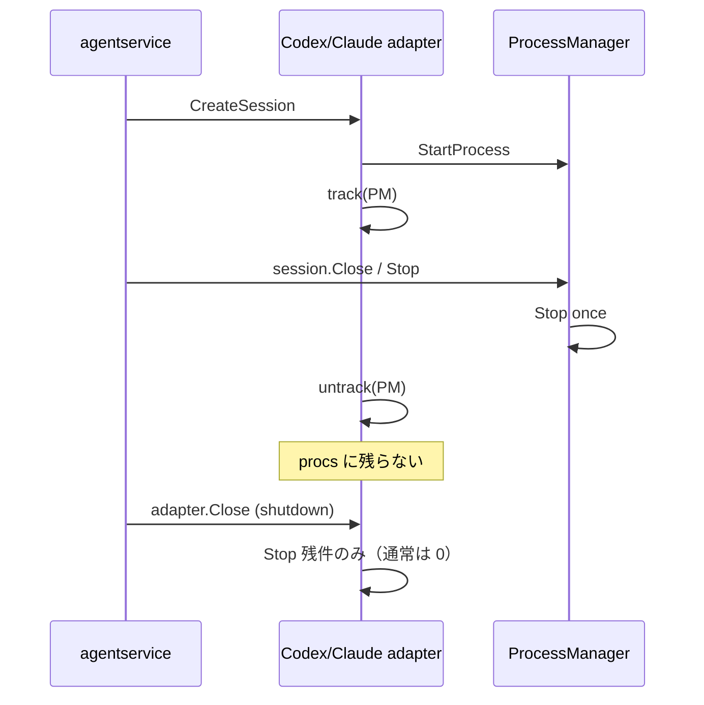

# 003: Coding Agent プロセスハンドルリークの解消（adapter procs）

## 背景 (Background)

### なぜ必要か

Turn interrupt（fallback replan）は、進行中の Coding Agent CLI を止めたうえで **新しい CLI プロセス**を起動する。voice barge-in のように短時間で interrupt が続くと、`CreateSession` 回数が急増する。

調査（ローカル `tmp/investigations/016-Codex-Process-Accumulation-On-Interrupt.md`。リポジトリには含めない）により、次が分かった。

1. interrupt / terminate 時点で親プロセス自体は停止されている（生きた親プロセスの残留証拠は無い）。
2. それでも tern 終了時に履歴上の全 PID へ連続 `taskkill` が走り、「プロセスが蓄積している」ように見える。
3. 原因は `CodexAdapter`（および同型の `ClaudeCodeAdapter`）が `procs []*ProcessManager` へ **append するだけで、session Close 時に除去しない**ことである。
4. `ProcessManager.Stop` に冪等ガードが無く、adapter `Close` が停止済み PM に再 `Stop` するためログノイズと無駄な OS 呼び出しが増える。

これは OS 上のゾンビというより、**アダプタが停止済みプロセスへの参照と関連リソースをサーバ寿命まで保持し続ける一種のメモリ／ハンドルリーク**である。interrupt 導入で顕在化したが、複数 turn（毎回 CreateSession）でも同型の肥大は起きる。

### 現状の課題

| 観点 | 現状 |
| :--- | :--- |
| `procs` リスト | `CreateSession` で append のみ。`codexSession.Close` / `claudeSession.Close` は `pm.Stop()` のみでリストから外さない |
| adapter `Close` | 履歴全件に `Stop` → 死んだ PID への再 `taskkill`（Windows では exit 128） |
| `Stop` | 二重呼び出し耐性が弱い |
| interrupt | fallback のたびに新規プロセスが増え、リーク速度が上がる |
| 子プロセス孤児 | Cancel 後の `taskkill /T` 失敗リスクは別件として先送り（backlog:e9a2417b-ef6b-491e-9f6c-a0e30c59774a） |

### スコープ

| 対象 | 内容 |
| :--- | :--- |
| 対象 | `shared/libs/go/codingagent/codex` と `claudecode` のプロセス追跡・停止の健全化 |
| 対象 | session Close 時の `procs` 除去、`Stop` の冪等化、adapter Close の振る舞い |
| 対象 | 上記を保証する単体テスト |
| 非対象 | agentservice の interrupt 意味論の変更 |
| 非対象 | Windows の Cancel / taskkill 順序や Job Object（先送り backlog） |
| 非対象 | Wayfinder（同型の `procs` リストを持たない） |
| 非対象 | native interrupt resume の本実装 |

---

## 要件 (Requirements)

### 必須要件 (Must)

#### M1. session Close で adapter 追跡から外す

- `codexSession.Close` / `claudeSession.Close`（または同等の停止完了経路）の後、対応する `ProcessManager` は当該 adapter の追跡集合（現行の `procs`）から除去されていなければならない。
- 除去はスレッドセーフであること（CreateSession / Close / adapter Close の競合でパニックや二重解放にならない）。

#### M2. adapter Close は「まだ追跡中」のプロセスだけを止める

- `CodexAdapter.Close` / `ClaudeCodeAdapter.Close` は、追跡集合に残っている ProcessManager だけを `Stop` し、その後集合を空にする。
- 既に session Close 済みのプロセスに対し、adapter Close が再び OS キル（`taskkill` 等）を試みないこと（M3 と合わせて保証）。

#### M3. `ProcessManager.Stop` の冪等性

- 同じ `ProcessManager` に対する複数回の `Stop` 呼び出しが安全であること（二回目以降は実質 no-op、パニックや不正な二重 Wait を起こさない）。
- 一度 `Stop` が完了した PM について、不要な再 `taskkill` / 再 Signal を避けること。

#### M4. Codex と Claude Code の対称性

- 両 adapter で M1〜M3 を満たすこと。片方だけの修正は不可。

#### M5. 公開契約を壊さない

- `codingagent.Session.Close` / `CodingAgent.Close` の意味（セッション終了・アダプタ解放）は維持する。
- interrupt / cancel / terminate / 通常 turn 完了の既存経路が、引き続きプロセスを停止できること（追跡から外すことで停止忘れが起きないこと）。

### 任意要件 (Nice to Have)

#### N1. 追跡集合の表現改善

- `[]*ProcessManager` を map や専用 registry に置き換えてもよい。外部 API に露出しない内部実装の選択は実装計画に委ねる。

#### N2. 停止完了の観測ログ

- session Close で追跡から外したこと、adapter Close 時の残件数などを debug ログに出してもよい（必須ではない）。

---

## 実現方針 (Implementation Approach)

### 設計方針

1. **リークの定義を「追跡参照の残留」に固定する**。生きた親プロセス残留の修正ではない（調査で否定済み）。停止済み PM を adapter が握り続けないことが本仕様の完了条件。
2. **停止の権威は session Close（および既に呼んでいる `finishExecution` / `stopInFlightTurn`）に置く**。adapter Close はサーバ終了時のセーフティネットであり、正常経路で空になっていることが望ましい。
3. **Stop を一度きりの終端操作にする**（`sync.Once` 相当）。Close と adapter Close のどちらが先でも安全。
4. **interrupt 経路は変更しない**。fallback が新規 CreateSession するのは現状仕様のまま。本仕様は「止めたら追跡から外す」側だけを直す。

### 想定コンポーネント

| 箇所 | 役割 |
| :--- | :--- |
| `codingagent/codex/adapter.go` | `procs` への登録・除去、adapter Close |
| `codingagent/codex/process.go` | `Stop` の冪等化 |
| `codingagent/claudecode/adapter.go` | 同上（対称） |
| `codingagent/claudecode` の ProcessManager | `Stop` の冪等化（codex と同趣旨） |
| `*_test.go`（同一パッケージ） | 追跡件数・二重 Stop・Close 順序の単体 |

### 処理フロー（理想）



### 仮の決定・先送り

- Windows の Cancel → taskkill 順序による子プロセス孤児化は本仕様の外とする。backlog:e9a2417b-ef6b-491e-9f6c-a0e30c59774a

---

## 検証シナリオ (Verification Scenarios)

1. **単発 Close で追跡が空になる**  
   (1) adapter で CreateSession を 1 回行う。(2) 返った session を Close する。(3) adapter 内部の追跡件数が 0 である。(4) その後 adapter Close しても追加のプロセスキル試行が実質 no-op である。

2. **複数 CreateSession → 個別 Close**  
   (1) 同一 adapter で CreateSession を N 回（N≥3）行う。(2) すべて Close する。(3) 追跡件数が 0。(4) adapter Close は残件 0 で終わる。

3. **二重 Stop**  
   (1) 1 session を得る。(2) `Stop`（または Close）を連続 2 回呼ぶ。(3) パニックせず、2 回目は no-op。

4. **Close せずに adapter Close（セーフティネット）**  
   (1) CreateSession のみ行い session Close しない。(2) adapter Close する。(3) プロセスは停止され、追跡は空になる。

5. **interrupt 連続の回帰イメージ（手動または既存統合の延長）**  
   (1) tern を起動し Codex で turn を開始する。(2) interrupt を数回行う。(3) session を terminate する。(4) tern を Ctrl+C で止める。(5) shutdown ログに、過去の全履歴 PID への連続 `killing process tree` が並ばない（残件が無いか、あっても未 Close の現役のみ）。(6) 可能なら OS 上に `codex.exe` が残っていないことを確認する。

---

## テスト項目 (Testing for the Requirements)

### 要件と検証の対応

| 要件 | 検証 |
| :--- | :--- |
| M1 追跡除去 | シナリオ 1・2 のパッケージ内単体（追跡件数アサーション） |
| M2 adapter Close | シナリオ 1・2・4 の単体 |
| M3 Stop 冪等 | シナリオ 3 の単体（codex / claudecode 双方） |
| M4 対称性 | 両パッケージに同等テストがあること |
| M5 既存経路 | ビルド＋既存単体の回帰。interrupt 統合の指定実行 |

### ビルド・自動化コマンド

1. ビルド＋単体テスト:

```bash
./scripts/process/build.sh
```

（Linux / Remote-SSH Linux では `./scripts/process/build.sh --skip-etc`）

2. codingagent adapter / process の単体に絞った確認（実装後のテスト名に合わせて調整）:

```bash
go test ./shared/libs/go/codingagent/codex/ ./shared/libs/go/codingagent/claudecode/ -count=1 -run 'TestAdapter_.*Close|TestProcessManager_StopIdempotent|TestAdapter_Untrack'
```

3. turn interrupt 回帰（agentservice 経路が Close を呼び続けることの確認）:

```bash
./scripts/process/integration_test.sh --specify 'TestTurnInterrupt_'
```

4. 影響が codingagent に閉じるため、全カテゴリ一括の `integration_test.sh`（オプションなし）は本仕様の必須検証に含めない。

シナリオ 5 の shutdown ログ目視は手動の補助確認とし、合否の主根拠は 1〜3 の自動検証とする。

---

## 非目標・後続

- Windows Cancel / taskkill 順序および Job Object → backlog:e9a2417b-ef6b-491e-9f6c-a0e30c59774a
- Native interrupt によるプロセス再利用（CreateSession 回数そのものの削減）→ 既存 interrupt 仕様の後続
- Wayfinder プロセス管理の見直し

---

## 参考

- 調査報告 016（ローカル `tmp/investigations/016-Codex-Process-Accumulation-On-Interrupt.md`。リポジトリには含めない）
- [000-Turn-Interrupt-And-Resume.md](000-Turn-Interrupt-And-Resume.md)
- `shared/libs/go/codingagent/codex/adapter.go`
- `shared/libs/go/codingagent/codex/process.go`
- `shared/libs/go/codingagent/claudecode/adapter.go`
- `shared/libs/go/agentservice/turn_stop.go`
