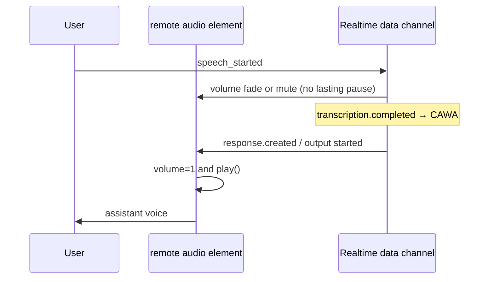

# 004: voice_demo Realtime アシスタント音声の再生復帰

## 背景 (Background)

### なぜ必要か

[002-Voice-Demo-Natural-Barge-In.md](prompts/phases/001-phase02/branches/feat-turn-interrupt-resume/ideas/002-Voice-Demo-Natural-Barge-In.md) で natural barge-in 用に、ユーザー発話開始時にリモート `<audio>` をフェードして止める処理を入れた。実機では次の症状が出た。

1. マイク入力は OpenAI Realtime で文字起こしされ、transcript に `you>` が出る。
2. その文字は CAWA へ `messages` / `interrupt` として送られる。
3. **OpenAI 側の会話音声が返ってこない**（聞こえない）。

接続自体は `realtime> connected` まで成功している。文字起こしイベントは data channel で届いている。したがって「Realtime が応答を生成していない」可能性より、**ブラウザの再生要素が pause されたまま、後続のアシスタント音声を再生しない**可能性が高い。

### 現状の課題

| 観点 | 現状 |
| :--- | :--- |
| barge-in 時 | `input_audio_buffer.speech_started` で `fadeAndPauseRemoteAudio()` が `remoteAudio.pause()` する |
| 復帰 | `response.created` / `output_audio_buffer.started` で status は `speaking` にするが、`play()` も音量復帰保証も無い |
| 結果 | 一度ユーザーが話すと、以降アシスタント音声が無音になり得る |
| 観測 | CAWA ログだけが進み、「OpenAI が黙った」ように見える |

### スコープ

| 対象 | 内容 |
| :--- | :--- |
| 対象 | `features/voice_demo/static/app.js` のリモート再生制御 |
| 対象 | 上記振る舞いを固定する自動検証（静的契約試験）と README の注意一文 |
| 非対象 | CAWA busy→interrupt ポリシーの変更 |
| 非対象 | Realtime session JSON（`interrupt_response`）の変更（002 のモードはそのまま） |
| 非対象 | 本番 Voice Mediator |

前提: [002-Voice-Demo-Natural-Barge-In.md](prompts/phases/001-phase02/branches/feat-turn-interrupt-resume/ideas/002-Voice-Demo-Natural-Barge-In.md)

---

## 要件 (Requirements)

### 必須要件 (Must)

#### M1. barge-in 後もアシスタント音声が聞こえること

ユーザーが一度話し、文字起こしが `you>` に出たあとでも、OpenAI Realtime が返すアシスタント音声をスピーカーで再生できること。

#### M2. speech_started で再生パイプラインを永久停止しないこと

`input_audio_buffer.speech_started` 時の処理は、自然さのための**音量フェードまたは一時ミュート**までとする。

禁止:

* barge-in 処理の結果として、リモート `<audio>` を `pause()` したまま、次のアシスタント発話で `play()` しないこと。

許可:

* abrupt: 音量を即 0 にする。
* natural: 短いフェードで音量を下げる（既存の FadeMs を流用してよい）。

#### M3. アシスタント発話開始で再生を復帰すること

少なくとも次のいずれか（または両方）を検知したら、リモート `<audio>` について:

1. `volume` を可聴レベル（既定 1）に戻す。
2. `play()` を呼び、拒否されてもデモが落ちないよう握りつぶす（autoplay ポリシー）。

対象イベント例: `response.created`、`output_audio_buffer.started`（既存の speaking 表示と同じフックでよい）。

#### M4. CAWA 経路を壊さないこと

文字起こし完了 → `/api/utterance` → idle=`messages` / busy=`interrupt` は 001/002 どおり維持する。

#### M5. 自動検証があること

ブラウザ実機の聞こえは手動でよいが、**再生復帰の契約**は `app.js` を読む自動試験で固定する（例: barge-in 用関数が `pause()` を呼ばない、またはアシスタント開始フックで `play(` を呼ぶ、がソース上保証されていること）。手動目視だけの検証計画は不可。

### 任意要件 (Should)

#### S1. transcript に realtime 再生復帰の一行

デバッグしやすいよう、復帰時に `realtime> resume playback` のような一行を出してよい（必須ではない）。

---

## 実現方針 (Implementation Approach)

1. `fadeAndPauseRemoteAudio` を改名または分割し、**`pause()` を使わない**フェード／ミュートにする（例: `softenRemoteAudioOnBargeIn`）。
2. `ensureRemoteAudioPlaying`（仮）を追加し、アシスタント発話開始イベントで volume 復帰 + `play()` する。
3. `static_assets_test.go` または新規 `app_js_assets_test.go` で `app.js` の契約文字列を断言する。
4. README に「barge-in 後も Realtime 音声が聞こえること／聞こえなければ本修正を確認」程度の一文を足す。



---

## 検証シナリオ (Verification Scenarios)

1. Tern を demo 設定で起動し、`OPENAI_API_KEY` と `TERN_URL` を付けて `voice_demo` を起動する。
2. ブラウザで Start call し、Realtime が `connected` になる。
3. 「こんにちは」と話し、文字起こしが `you>` に出ることを確認する。
4. **アシスタントの声が聞こえる**ことを確認する（無音にならないこと）。
5. アシスタント発話中または直後に再度話し、文字起こしが出たあとでも、次のアシスタント発話が聞こえることを確認する。
6. abrupt / natural の両方で 4–5 を繰り返す（natural はフェードがあっても復帰すること）。
7. 同じセッションで long-task ボタン後の busy→`interrupt` が従来どおり transcript に出ること（CAWA 回帰）。

観測ログ例（ユーザー報告）では、文字起こしと CAWA だけが進み音声が無かった。修正後は同じ操作で音声が戻ること。

---

## テスト項目 (Testing for the Requirements)

| 要件 | 自動検証 |
| :--- | :--- |
| M2 / M3 / M5 | `features/voice_demo` の `app.js` 契約試験（`go test`、`TestAppJSResumesRemoteAudioAfterBargeIn` 等） |
| M4 | 既存 `TestUtteranceHandler_IdleMessagesBusyInterrupt` |
| 全体 | `scripts/process/build.sh` |
| 回帰 | `scripts/process/integration_test.sh --specify 'TestTurnInterrupt_'`（CAWA interrupt 契約。voice_demo JS 以外の副作用確認） |

### ビルド・全体検証

1. ビルド＋単体テスト:

```bash
./scripts/process/build.sh
```

2. Turn interrupt 回帰:

```bash
./scripts/process/integration_test.sh --specify 'TestTurnInterrupt_'
```

3. feature 単体の絞り込み（開発中）:

```bash
cd features/voice_demo && go test -count=1 -v -run 'TestAppJS|TestUtteranceHandler_IdleMessagesBusyInterrupt|TestStaticIndex'
```

聞こえ（シナリオ 4–6）は手動。契約試験が M2/M3 のコード上の不変条件を担う。
