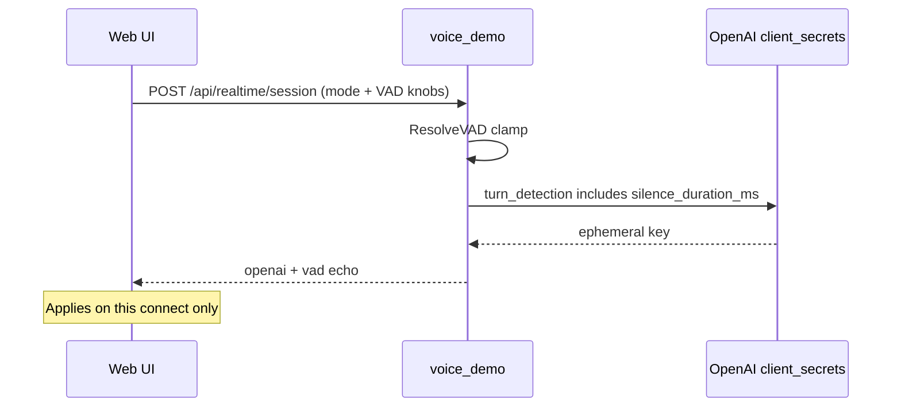

# 005: voice_demo VAD 発話終了待ちの Web UI 調整

## 背景 (Background)

### なぜ必要か

Realtime の「自然さ」のうち、ユーザーが求めているのは次の体験である。

* 自分の発話が**完了したあと**は、すぐにアシスタントが応答してよい。
* 発話の**途中**（言い淀み・短い無音の間）では、待ってほしい。すぐ割り込んで応答してほしくない。

現状の `voice_demo` は abrupt / natural（`interrupt_response` と再生フェード）を UI で選べるが、**発話終了判定（server_vad の無音長）**は API 既定のままである。そのため natural でも「間を待たずに応答が始まる」と感じやすい。

この調整はコードを直すたびに再ビルドするより、**Web UI でパラメータを触って耳で合わせる**方が Example として適切である。

### 現状の課題

| 観点 | 現状 |
| :--- | :--- |
| 発話終了待ち | `turn_detection` に `silence_duration_ms` 等を載せていない |
| UI | barge-in モードのみ。VAD 待ちのノブが無い |
| 反映タイミング | session 作成時の JSON に載せる必要がある（通話中のライブ変更は別問題） |

### スコープ

| 対象 | 内容 |
| :--- | :--- |
| 対象 | Web UI での VAD 終了判定パラメータ表示・編集 |
| 対象 | `POST /api/realtime/session` 経由で OpenAI `client_secrets` の `turn_detection` に反映 |
| 対象 | 既定値・許容レンジのクランプと README |
| 非対象 | CAWA の busy→interrupt タイミング |
| 非対象 | 通話中に VAD を OpenAI へ session.update でライブ変更する高度経路（初版は「次の Realtime 接続から有効」でよい） |
| 非対象 | 本番 Voice Mediator |

前提: [002-Voice-Demo-Natural-Barge-In.md](prompts/phases/001-phase02/branches/feat-turn-interrupt-resume/ideas/002-Voice-Demo-Natural-Barge-In.md)、[004-Voice-Demo-Realtime-Audio-Resume.md](prompts/phases/001-phase02/branches/feat-turn-interrupt-resume/ideas/004-Voice-Demo-Realtime-Audio-Resume.md)

### 仮の決定

* backlog:c9419909-5bd6-4d73-93e9-a54445c82c15 — UI 初期値とレンジ（silence 900ms など）

---

## 要件 (Requirements)

### 必須要件 (Must)

#### M1. Web UI で発話終了待ちを調整できること

画面上に、少なくとも次を編集できるコントロールを置く（`data-testid` 必須）。

| パラメータ | testid（例） | 意味 |
| :--- | :--- | :--- |
| `silence_duration_ms` | `vad-silence-ms` | 無音が続いたら発話終了とみなす長さ。大きいほど「間」を待ちやすい |
| `threshold` | `vad-threshold` | server_vad の感度（0.0–1.0） |
| `prefix_padding_ms` | `vad-prefix-ms` | 発話先頭のパディング |

各コントロールに短い説明文を添える（日本語または英語。Example として「話し終わり待ち」「感度」が分かること）。

#### M2. Start call（Realtime 接続）時に OpenAI へ渡すこと

`POST /api/realtime/session` のリクエストに上記値を含め、サーバが `createRealtimeEphemeralSession` の `session.audio.input.turn_detection` に載せる。

既存の `barge_in_mode` / `interrupt_response` / fade は維持する。VAD 待ちパラメータは barge-in モードとは独立（モード切替で UI の VAD 値を消さない）。

#### M3. サーバ側で安全にクランプすること

不正値・欠落時はサーバがクランプまたは既定にフォールバックする（デモが 500 で落ちないこと）。

仮の既定とレンジ（backlog:c9419909-5bd6-4d73-93e9-a54445c82c15）:

| キー | 既定 | 最小 | 最大 |
| :--- | ---: | ---: | ---: |
| `silence_duration_ms` | 900 | 200 | 2000 |
| `threshold` | 0.5 | 0.0 | 1.0 |
| `prefix_padding_ms` | 300 | 0 | 1000 |

#### M4. 反映タイミングを UI で明示すること

初版は **次に Realtime を接続したとき**（Start call、または Realtime 再接続）から有効。通話中スライダー変更だけでは OpenAI 側に即時反映しない。

画面に一文で示す（例: “Applies on next Realtime connect”）。

#### M5. 適用値が見えること

接続成功時、transcript または Realtime パネル付近に、実際に使った VAD 値を一行出す（サーバ応答のエコー、またはクライアントが送った値）。`data-testid` 例: `vad-applied`。

#### M6. 自動検証

* Go: リクエストの VAD フィールドが `turn_detection` JSON に入ること、クランプが効くこと。
* 静的: `index.html` に testid があること。
* 既存 utterance / app.js resume / barge-in 試験を壊さないこと。

### 任意要件 (Should)

#### S1. 「推奨プリセット」ボタン

例: `Responsive`（silence=500）、`Patient`（silence=1200）でスライダーをまとめてセット。必須ではない。

#### S2. 通話中の session.update

Realtime data channel で `session.update` してライブ反映。初版ではやらなくてよい（複雑さと API 差のため）。

---

## 実現方針 (Implementation Approach)

1. **型**: `BargeInParams` を拡張するか、隣接する `TurnDetectionParams` / `VADParams` を新設し、`ResolveBargeIn` とは別に `ResolveVAD(input) VADParams`（クランプ）を置く。
2. **API**: `handleRealtimeSession` が JSON で `silence_duration_ms` / `threshold` / `prefix_padding_ms` を受け、応答の `barge_in` または `vad` オブジェクトにエコーする。
3. **Realtime payload**: `turn_detection` に `type`, `interrupt_response`, `silence_duration_ms`, `threshold`, `prefix_padding_ms` を載せる。
4. **UI**: barge-in 行の下に VAD 調整行。`app.js` が Start / connectRealtime 時に値を POST。
5. **ビルド注意**: `voice_demo` は別 go.mod のため、README は `go build -C features/voice_demo -o ../../bin/voice_demo .` を維持・修正する。



---

## 検証シナリオ (Verification Scenarios)

1. `voice_demo` を起動し、ブラウザで VAD コントロール（silence / threshold / prefix）が見える。
2. `silence_duration_ms` を小さめ（例: 300）にして Start call。短い間でもアシスタントが早く入ることがあることを感じる（比較用）。
3. End したあと、`silence_duration_ms` を大きめ（例: 1200）にして再度 Start。発話の途中の短い間では待ち、話し終わってから応答することを感じる。
4. transcript または `vad-applied` に、接続時の適用値が出る。
5. 通話中にスライダーだけ動かしても、説明文どおりすぐには変わらない（再接続後に変わる）。
6. abrupt / natural を切り替えても、VAD スライダー値が消えない。
7. long-task ボタンと CAWA interrupt が従来どおり動く。

---

## テスト項目 (Testing for the Requirements)

| 要件 | 自動検証 |
| :--- | :--- |
| M1 | `TestStaticIndexHasVADControls`（または既存 static 試験の拡張） |
| M2 / M3 | `TestCreateRealtimeEphemeralSession_*` で turn_detection に silence/threshold/prefix が入ること、クランプ試験 |
| M5 | session ハンドラ試験で応答に vad エコーがあること（任意で httptest） |
| 回帰 | `TestAppJSResumesRemoteAudioAfterBargeIn`、`TestUtteranceHandler_IdleMessagesBusyInterrupt`、`TestResolveBargeIn` |

### ビルド・全体検証

1. ビルド＋単体:

```bash
./scripts/process/build.sh
```

2. Turn interrupt 回帰:

```bash
./scripts/process/integration_test.sh --specify 'TestTurnInterrupt_'
```

3. feature 絞り込み:

```bash
go test -C features/voice_demo -count=1 -v -run 'TestResolve|TestCreateRealtime|TestStatic|TestAppJS|TestUtterance'
```

聞こえと「間の待ち」の主観は手動（シナリオ 2–3）。
