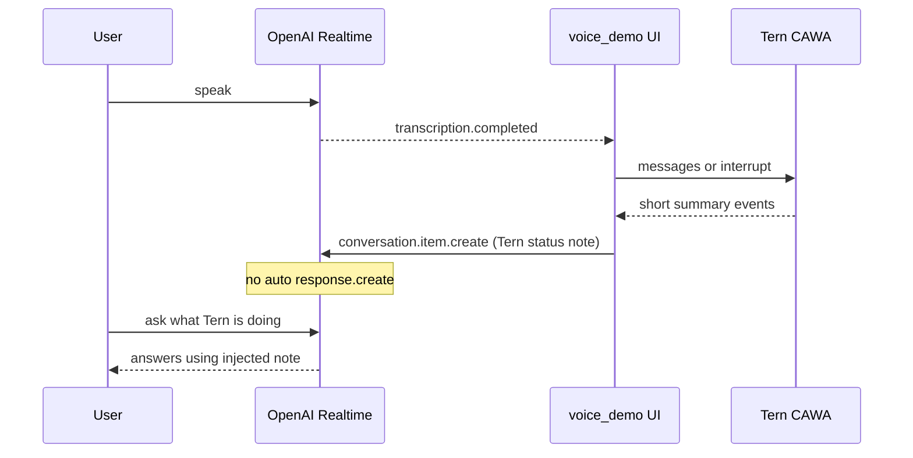

# 006: voice_demo の声質・速度 UI と Voice↔Tern コンテキスト橋渡し

## 背景 (Background)

### なぜ必要か

`features/voice_demo` では OpenAI Realtime（会話音声）と Tern CAWA（Coding Agent 実行）を二層に分けている。体験を合わせるうえで、次の不足が分かった。

1. **声質・速度**: Realtime API は `audio.output.voice` と `audio.output.speed` をサポートするが、デモは `marin` 固定で、UI からも変えられない。声の一覧を取る口も無い。
2. **コンテキスト分離**: ユーザー発話の文字起こしは CAWA に流れる一方、CAWA の作業進捗・結果は Realtime の会話コンテキストにほとんど戻っていない。そのため「いま Tern は何をしている？」と Voice に聞いても、Voice 側が知らないことが多い。

デモの学習目的（二層分離を見せつつ、人が使える体験にする）には、**(A) 声質・速度の調整**と **(B) CAWA→Realtime への短い状況共有**の両方が必要である。

### 現状の課題

| 観点 | 現状 |
| :--- | :--- |
| voice | `realtime.go` で `marin` 固定。一覧 API 無し |
| speed | session JSON に未設定（API 既定 1.0） |
| CAWA→Realtime | `last_summary` は UI 表示のみ。Realtime には注入しない |
| Realtime→CAWA | 文字起こし確定後の utterance のみ（意図した経路） |

### スコープ

| 対象 | 内容 |
| :--- | :--- |
| 対象 | 声質一覧 API（デモ提供）と Web UI での voice / speed 指定 |
| 対象 | Start（Realtime 接続）時に `client_secrets` の output へ反映 |
| 対象 | CAWA の短い作業要約を Realtime 会話へ橋渡しする仕組み（デモ範囲） |
| 非対象 | 本番 Voice Mediator での単一コンテキスト設計（別 idea） |
| 非対象 | CAWA 履歴への Realtime 全文の双方向同期（初版見送り可） |
| 非対象 | カスタム voice の録音作成フロー |

前提: [001-Voice-Demo-Web-App.md](prompts/phases/001-phase02/branches/feat-turn-interrupt-resume/ideas/001-Voice-Demo-Web-App.md)、[005-Voice-Demo-VAD-Turn-End-UI.md](prompts/phases/001-phase02/branches/feat-turn-interrupt-resume/ideas/005-Voice-Demo-VAD-Turn-End-UI.md)

### 仮の決定

* backlog:1a4face0-8fce-4e14-b088-61ab57268234 — 声質一覧はデモ側カタログ API
* backlog:f249c87e-ecb3-474c-bd79-4b8d38432fea — CAWA→Realtime は短い要約の片方向注入

---

## 要件 (Requirements)

### 必須要件 (Must)

#### M1. 声質一覧を取得できる API

デモサーバが次を提供する。

* `GET /api/realtime/voices`
* 応答例:

```json
{
  "ok": true,
  "default": "marin",
  "voices": [
    { "id": "marin", "label": "Marin", "recommended": true },
    { "id": "cedar", "label": "Cedar", "recommended": true },
    { "id": "alloy", "label": "Alloy" }
  ],
  "source": "curated"
}
```

* OpenAI に安定した list エンドポイントが無い／使わない場合でも、デモがキュレート一覧を返す（backlog:1a4face0-8fce-4e14-b088-61ab57268234）。
* 少なくとも docs 上の built-in（`alloy`, `ash`, `ballad`, `coral`, `echo`, `sage`, `shimmer`, `verse`, `marin`, `cedar`）を含める。
* `data-testid` 不要（HTTP）。クライアントは Start 前にこの API で `<select>` を埋めてよい。

#### M2. Web UI で voice を指定できること

* `<select data-testid="realtime-voice">`（または同等）。一覧は M1 から取得。取得失敗時は `marin` のみのフォールバック。
* 選択値は `POST /api/realtime/session` に `voice` として送り、`audio.output.voice` に載せる。
* **反映は次の Realtime 接続から**（voice は一度音声応答した後セッション内変更不可、という API 制約に合わせ、Start し直しを UI 注記する）。

#### M3. Web UI で speed を指定できること

* コントロール `data-testid="realtime-speed"`（number または range）。
* レンジ仮: **0.25〜1.5**、既定 **1.0**、ステップ 0.05 程度。サーバでクランプ。
* `POST /api/realtime/session` に `speed` を含め、`audio.output.speed` に載せる。
* 反映は次の Realtime 接続から（ターン途中変更は初版対象外。注記する）。

#### M4. 適用値の可視化

接続成功時、transcript またはパネルに `voice=... speed=...` を一行出す（`data-testid="realtime-output-applied"` など）。

#### M5. CAWA→Realtime コンテキスト橋渡し（片方向）

二層は維持したまま、**実行層の短い状況を会話層へ渡す**。

1. CAWA の `messages` / `interrupt` ストリームから既に作っている短い要約（`last_summary` 相当、切り詰め済み）を、進捗の区切りでブラウザが受け取る（既存 utterance 応答または status ポーリングで足りるならそれを使う）。
2. Realtime data channel が開いているとき、ブラウザは要約を **会話アイテムとして注入**する（仮: `conversation.item.create` で、モデル向けの短いノート。例: 「Tern coding agent status: …」）。全文ログ・巨大ツール出力は送らない（既存 summarize の上限に従う）。
3. 注入後、必要なら短い `response.create` は**自動では呼ばない**（勝手に喋り始めない）。ユーザーが状況を聞いたときに答えられることを優先する。
4. UI に「Context bridge: on/off」トグル（`data-testid="context-bridge"`）を置き、既定は **on**。off なら注入しない（二層が完全分離の比較用）。

方式の仮決定: backlog:f249c87e-ecb3-474c-bd79-4b8d38432fea。

#### M6. 自動検証

* voices 一覧 API の JSON 形状と必須 id の存在。
* session 作成リクエストに `voice` / `speed` が載ること、不正 speed のクランプ。
* コンテキスト橋渡し: 注入ペイロードを組み立てる純関数（または JS 契約試験）で「要約が空なら送らない」「プレフィックスと長さ上限」を固定。ブラウザ実接続は手動。
* 既存 VAD / barge-in / utterance / audio resume 試験を壊さないこと。

### 任意要件 (Should)

#### S1. speed のプリセット

例: Slow 0.8 / Normal 1.0 / Fast 1.25。

#### S2. 橋渡しの transcript 一行

`bridge> tern status: ...` を transcript に出し、注入したことが分かるようにする。

#### S3. Realtime→CAWA のメタ付与

Voice 側の短い意図ラベルを utterance に付ける等。初版では必須にしない。

---

## 実現方針 (Implementation Approach)

### A. 声質・速度

1. `voices.go`: キュレート定数 + `handleVoices`。
2. `ResolveOutputAudio(voice string, speed float64) (voice string, speed float64)` で未知 voice は default、speed はクランプ。
3. `createRealtimeEphemeralSession` の `audio.output` に `voice` と `speed` を載せる（既存 VAD / barge-in と併存）。
4. UI: VAD 行の近くに voice select と speed。Start 時 POST に含める。

### B. コンテキスト橋渡し



1. `app.js`: utterance 応答の `summary`（または status の `last_summary` 変化）を検知。
2. bridge on かつ data channel open なら、JSON イベントを送る。
3. Go 側に `BuildContextBridgeNote(summary string) (note string, ok bool)` を置き、空・重複・過長を弾く（単体試験容易）。

### C. やらないこと（初版）

* CAWA の canonical history と Realtime transcript の完全マージ。
* 本番 Mediator の単一セッションモデルへの昇格。

---

## 検証シナリオ (Verification Scenarios)

### 声質・速度

1. ページを開き、voice の選択肢が一覧 API 由来で複数ある。
2. voice を `cedar`（または別 voice）に、speed を `1.25` にして Start。適用表示に同じ値が出る。
3. アシスタント音声の声・速さが、既定 `marin` / `1.0` のときと違うことを耳で確認する。
4. End 後、speed `0.8` で Start し直し、遅く聞こえること。
5. 通話中だけ speed を動かしても、注記どおりすぐには変わらない（再接続後に変わる）。

### コンテキスト橋渡し

6. bridge on で Start。long-task または発話で CAWA を busy にし、要約が出る。
7. transcript に bridge 行（S2 実装時）または Realtime が後の質問「今 Tern は何してる？」に、注入した要約に沿った答えをする（手動）。
8. bridge off で同様に CAWA を動かし、同じ質問をすると、作業内容を知らない／一般論になりやすいことを比較する（手動）。
9. abrupt/natural・VAD・CAWA interrupt が従来どおり動く。

---

## テスト項目 (Testing for the Requirements)

| 要件 | 自動検証 |
| :--- | :--- |
| M1 | `TestVoicesHandler_ListsCuratedVoices` |
| M2 / M3 | `TestCreateRealtimeEphemeralSession_PostsVoiceAndSpeed`、クランプ試験 |
| M4 | static testid / 応答エコー試験 |
| M5 | `TestBuildContextBridgeNote`（空・切り詰め・プレフィックス） |
| 回帰 | 既存 voice_demo 単体、`TestTurnInterrupt_` |

### ビルド・全体検証

1. ビルド＋単体:

```bash
./scripts/process/build.sh
```

2. Turn interrupt 回帰:

```bash
./scripts/process/integration_test.sh --specify 'TestTurnInterrupt_'
```

3. feature 絞り込み:

```bash
go test -C features/voice_demo -count=1 -v -run 'TestVoices|TestResolve|TestCreateRealtime|TestBuildContext|TestStatic|TestAppJS|TestUtterance'
```

聞こえ・橋渡し後の受け答えは手動（シナリオ 3–4、7–8）。
