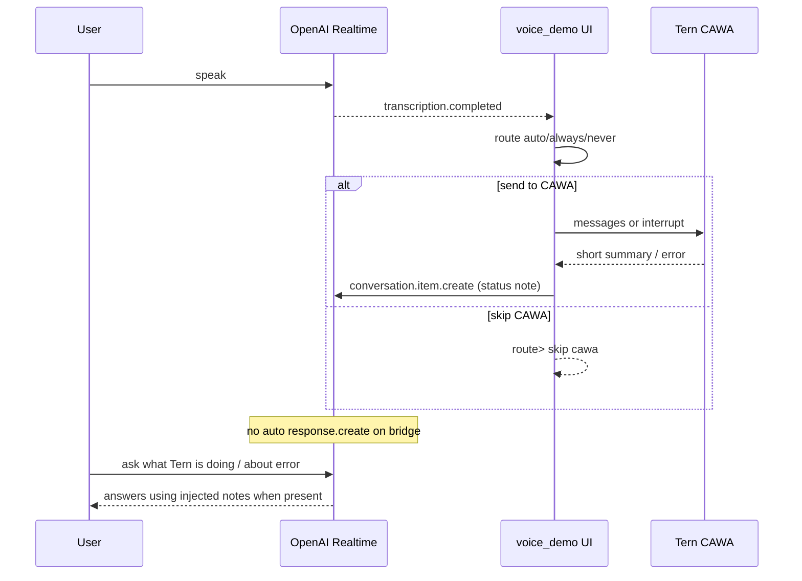

# 006: voice_demo の声質・速度 UI、コンテキスト橋渡し、発話ルーティング、Realtime 同時応答

## 背景 (Background)

### なぜ必要か

`features/voice_demo` では OpenAI Realtime（会話音声）と Tern CAWA（Coding Agent 実行）を二層に分けている。体験を合わせるうえで、次の不足が分かった。

1. **声質・速度**: Realtime API は `audio.output.voice` と `audio.output.speed` をサポートするが、デモは `marin` 固定で、UI からも変えられない。声の一覧を取る口も無い。
2. **コンテキスト分離**: ユーザー発話の文字起こしは CAWA に流れる一方、CAWA の作業進捗・結果は Realtime の会話コンテキストにほとんど戻っていない。そのため「いま Tern は何をしている？」と Voice に聞いても、Voice 側が知らないことが多い。
3. **発話の全部転送**: 雑談・状況確認・メタ発言（「エラーになった」等）まで全て CAWA に送るため、busy 中は連続 `interrupt` となり Coding Agent が飢餓する（調査 017）。見た目は「Voice だけ動いて Tern が壊れている」。
4. **Realtime 同時応答**: `conversation_already_has_active_response` が natural 利用時に出る。先行応答が残るまま次応答が起きると OpenAI がエラーを返す（調査 017）。これは Tern のエラーではないが、橋渡しが無いと Voice が事実を説明できない。

デモの学習目的（二層分離を見せつつ、人が使える体験にする）には、**(A) 声質・速度**、**(B) CAWA→Realtime の短い状況共有**、**(C) 発話ルーティング**、**(D) Realtime 同時応答の整合**が必要である。

### 現状の課題

| 観点 | 現状 |
| :--- | :--- |
| voice | `realtime.go` で `marin` 固定。一覧 API 無し |
| speed | session JSON に未設定（API 既定 1.0） |
| CAWA→Realtime | `last_summary` は UI 表示のみ。Realtime には注入しない |
| Realtime→CAWA | 文字起こし確定のたびに必ず `/api/utterance` |
| busy ポリシー | idle→`messages`、busy→常に `interrupt`（意図した MVP） |
| Realtime 応答 | natural は `interrupt_response=false`。active response 追跡なし |
| transcript ノイズ | `resume playback` が `response.created` と `output_audio_buffer.started` の両方で出る |

### スコープ

| 対象 | 内容 |
| :--- | :--- |
| 対象 | 声質一覧 API（デモ提供）と Web UI での voice / speed 指定 |
| 対象 | Start（Realtime 接続）時に `client_secrets` の output へ反映 |
| 対象 | CAWA の短い作業要約・エラー要約を Realtime 会話へ橋渡しする仕組み |
| 対象 | 発話を CAWA に送るか送らないかのルーティング（デモ方針） |
| 対象 | Realtime の active response 衝突回避と transcript ノイズ低減 |
| 非対象 | 本番 Voice Mediator での単一コンテキスト設計（別 idea） |
| 非対象 | CAWA 履歴への Realtime 全文の双方向同期 |
| 非対象 | カスタム voice の録音作成フロー |
| 非対象 | Codex sandbox / work_dir 製品設定の変更（README・UI での明示は可） |

前提:

* [001-Voice-Demo-Web-App.md](prompts/phases/001-phase02/branches/feat-turn-interrupt-resume/ideas/001-Voice-Demo-Web-App.md)
* [005-Voice-Demo-VAD-Turn-End-UI.md](prompts/phases/001-phase02/branches/feat-turn-interrupt-resume/ideas/005-Voice-Demo-VAD-Turn-End-UI.md)
* 調査: `tmp/investigations/017-Voice-Demo-Realtime-Error-And-Tern-Starvation.md`（gitignore。番号と題名で参照）

### 仮の決定

* backlog:1a4face0-8fce-4e14-b088-61ab57268234 — 声質一覧はデモ側カタログ API
* backlog:f249c87e-ecb3-474c-bd79-4b8d38432fea — CAWA→Realtime は短い要約の片方向注入
* backlog:884801c1-cc4a-4376-b835-2bc9fe788769 — 発話の CAWA 転送ルーティング（auto 既定）
* backlog:8ab16550-3079-4145-baf3-4ae3e3a010a4 — Realtime 同時応答の扱い（cancel 整合）

---

## 要件 (Requirements)

### 必須要件 (Must)

#### M1. 声質一覧を取得できる API

デモサーバが次を提供する。

* `GET /api/realtime/voices`
* 応答例:

```json
{
  "ok": true,
  "default": "marin",
  "voices": [
    { "id": "marin", "label": "Marin", "recommended": true },
    { "id": "cedar", "label": "Cedar", "recommended": true },
    { "id": "alloy", "label": "Alloy" }
  ],
  "source": "curated"
}
```

* OpenAI に安定した list エンドポイントが無い／使わない場合でも、デモがキュレート一覧を返す（backlog:1a4face0-8fce-4e14-b088-61ab57268234）。
* 少なくとも docs 上の built-in（`alloy`, `ash`, `ballad`, `coral`, `echo`, `sage`, `shimmer`, `verse`, `marin`, `cedar`）を含める。

#### M2. Web UI で voice を指定できること

* `<select data-testid="realtime-voice">`。一覧は M1 から取得。失敗時は `marin` のみ。
* `POST /api/realtime/session` に `voice` を送り、`audio.output.voice` に載せる。
* **反映は次の Realtime 接続から**（API 制約: 一度音声応答後はセッション内で voice 変更不可）。UI に注記する。

#### M3. Web UI で speed を指定できること

* `data-testid="realtime-speed"`。レンジ仮 **0.25〜1.5**、既定 **1.0**。サーバでクランプ。
* `POST /api/realtime/session` に `speed` を含め、`audio.output.speed` に載せる。
* 反映は次の Realtime 接続から。注記する。

#### M4. 適用値の可視化

接続成功時、`voice=... speed=...` を一行出す（`data-testid="realtime-output-applied"`）。

#### M5. CAWA→Realtime コンテキスト橋渡し（片方向）

二層は維持したまま、**実行層の短い状況を会話層へ渡す**。

1. CAWA の要約（`last_summary`、interrupt、error 相当の短い文）をブラウザが受け取る。
2. Realtime data channel が開いているとき、要約を会話アイテムとして注入する（仮: `conversation.item.create`。例: 「Tern coding agent status: …」）。全文ログは送らない。
3. 注入後に自動 `response.create` は**呼ばない**。
4. トグル `data-testid="context-bridge"`、既定 **on**。
5. 橋渡し対象には少なくとも次を含める: turn started / busy 継続の短い進捗 / turn finished / interrupt / **error 要約**（調査 017 の悪循環対策）。

方式: backlog:f249c87e-ecb3-474c-bd79-4b8d38432fea。

#### M6. 発話ルーティング（Realtime のみ vs CAWA 転送）

文字起こし確定のたびに必ず CAWA へ送る現状を改める（backlog:884801c1-cc4a-4376-b835-2bc9fe788769）。

1. UI に転送モード `data-testid="cawa-route-mode"`:
   * `always` — 現行どおり全発話を CAWA へ（比較・デバッグ用）
   * `never` — Realtime のみ（CAWA に送らない）
   * `auto` — **既定**。ヒューリスティックで転送可否を決める
2. `auto` の仮ルール（実装で表に固定し試験する）:
   * CAWA が **idle** かつ発話が作業指示らしい（長さ・キーワード等の簡易条件）→ `messages`
   * CAWA が **busy** かつ発話が明確な作業変更・停止指示らしい → `interrupt`
   * それ以外（短いあいづち、状況確認、メタ苦情、「エラー？」等）→ **CAWA に送らない**（Realtime 会話のみ）。transcript に `route> skip cawa (...)` を出す
3. ルーティング結果は transcript と（可能なら）CAWA パネル付近で追えること。
4. `always` にすれば 001 の「全発話 barge-in デモ」を再現できること。

#### M7. Realtime 同時応答の整合

`conversation_already_has_active_response` をデモとして扱えるようにする（backlog:8ab16550-3079-4145-baf3-4ae3e3a010a4）。

1. クライアントが active response の有無を追跡する（`response.created` → active、`response.done` / キャンセル完了 → idle）。
2. natural（`interrupt_response=false`）でも、ユーザー発話開始や新規応答が必要なとき、**先行応答を `response.cancel` してから**次に進むか、active 中は新規応答生成を起こさない、のどちらか（または併用）を実装する。natural の聞こえ（即切断の回避）と矛盾しない範囲で選ぶ。
3. Realtime `error` のうち当該コードは transcript に出し、可能なら橋渡しノートにも短い事実を載せる（「Realtime: active response conflict」程度）。
4. `ensureRemoteAudioPlaying` の transcript 行は、再生復帰あたり **1 回に間引く**（`response.created` と `output_audio_buffer.started` の二重ログをやめる）。

#### M8. 自動検証

* voices 一覧 API の JSON 形状と必須 id。
* session に `voice` / `speed` が載ること、speed クランプ。
* `BuildContextBridgeNote`（空・切り詰め・error 含むプレフィックス）。
* ルーティング純関数: idle/busy × 発話サンプル → send/skip と action。
* active-response 状態機械の単体（または JS 契約）: cancel/抑止の分岐。
* 既存 VAD / barge-in / utterance（`always` モード）/ audio resume 契約を壊さないこと。

### 任意要件 (Should)

#### S1. speed のプリセット

Slow 0.8 / Normal 1.0 / Fast 1.25。

#### S2. 橋渡しの transcript 一行

`bridge> tern status: ...`

#### S3. 作業ディレクトリの明示

UI または README に、デモの `work_dir` が一時ディレクトリであること、エージェント sandbox が read-only になりうることを書く（調査 017 F5）。設定変更自体は非対象。

#### S4. 手動「Send to Tern」ボタン

`auto`/`never` でも、今の transcript 最終発話やテキスト欄を明示的に CAWA へ送れるとよい。

---

## 実現方針 (Implementation Approach)

### A. 声質・速度

1. `voices.go`: キュレート定数 + `GET /api/realtime/voices`。
2. `ResolveOutputAudio` で voice / speed を正規化。
3. `createRealtimeEphemeralSession` の `audio.output` に載せる。
4. UI: voice select と speed。Start 時 POST。

### B. コンテキスト橋渡し



1. `BuildContextBridgeNote`（Go）で注入文を組み立て、試験する。
2. `app.js` が status / utterance 結果の変化で注入。bridge off なら送らない。

### C. ルーティング

1. `DecideUtteranceRoute(busy bool, text string, mode string) (send bool, action Action, reason string)` を Go（または JS と二重にせずサーバ or 共有しやすい Go）に置く。
2. `always` は現行 `DecideUtteranceAction` 相当。`never` は send=false。`auto` は表駆動。
3. ブラウザは mode を見て `/api/utterance` を呼ぶかスキップする。サーバ側でも mode を受けて拒否できるようにすると安全。

### D. Realtime 同時応答

1. `app.js` に `realtimeResponseActive` フラグ。
2. speech_started または衝突エラー時: `response.cancel` を data channel へ送る（API イベント名は実装時に Realtime 現行 docs に合わせる）。
3. cancel 完了または `response.done` まで新規応答を起こさない。
4. resume ログは単一フックに限定。

### E. やらないこと（初版）

* CAWA canonical history と Realtime transcript の完全マージ。
* 本番 Mediator への昇格。
* LLM による高度な意図分類。

---

## 検証シナリオ (Verification Scenarios)

### 声質・速度

1. ページを開き、voice 選択肢が一覧 API 由来で複数ある。
2. voice=`cedar`、speed=`1.25` で Start。適用表示が一致する。
3. 声・速さが既定と違うことを耳で確認する。
4. End 後 speed=`0.8` で Start し直し、遅く聞こえる。
5. 通話中だけの変更はすぐ反映されない（注記どおり）。

### コンテキスト橋渡し

6. bridge on で CAWA を動かし、要約または error 要約が注入される（transcript の bridge 行または後続の質問で確認）。
7. 「今 Tern は何してる？」「さっきエラー？」に、注入内容に沿った答えができる（手動）。
8. bridge off では同じ質問に作業内容が分からない／一般論になりやすい。

### ルーティング

9. mode=`always` で「こんにちは」→ CAWA `messages`、続けて発話 → `interrupt`（現行デモ再現）。
10. mode=`auto` で「こんにちは」など短いあいさつ → **CAWA に送らない**（または送っても idle の作業指示扱いをしない）。Realtime だけが応答する。
11. mode=`auto`、明示的な作業指示（例: long-task ボタンまたは「60秒 sleep してファイルを作って」）→ CAWA `messages`。完了まで雑談しても、確認系は skip され interrupt 嵐にならない。
12. mode=`never` では long-task 以外で CAWA が動かない。

### Realtime 同時応答

13. natural で連続発話しても、`conversation_already_has_active_response` が再現しにくい（または出ても cancel 後に回復し、連続エラーにならない）。
14. `resume playback` が応答あたり過剰に連打されない。

### 回帰

15. abrupt/natural・VAD・`always` 時の interrupt 経路・audio resume 契約が従来どおり。

---

## テスト項目 (Testing for the Requirements)

| 要件 | 自動検証 |
| :--- | :--- |
| M1 | `TestVoicesHandler_ListsCuratedVoices` |
| M2 / M3 | `TestCreateRealtimeEphemeralSession_PostsVoiceAndSpeed`、クランプ |
| M4 | static testid / エコー |
| M5 | `TestBuildContextBridgeNote`（進捗・error） |
| M6 | `TestDecideUtteranceRoute`（always/never/auto × idle/busy × サンプル発話） |
| M7 | active-response 状態の単体または `app.js` 契約（cancel / 二重 resume ログ禁止） |
| 回帰 | `TestUtteranceHandler_*`（always 相当）、`TestAppJSResumesRemoteAudioAfterBargeIn`、`TestTurnInterrupt_` |

### ビルド・全体検証

1. ビルド＋単体:

```bash
./scripts/process/build.sh
```

2. Turn interrupt 回帰:

```bash
./scripts/process/integration_test.sh --specify 'TestTurnInterrupt_'
```

3. feature 絞り込み:

```bash
go test -C features/voice_demo -count=1 -v -run 'TestVoices|TestResolve|TestCreateRealtime|TestBuildContext|TestDecideUtteranceRoute|TestStatic|TestAppJS|TestUtterance'
```

聞こえ・橋渡し後の受け答え・同時応答の主観は手動（シナリオ 3–4、7、11、13）。
