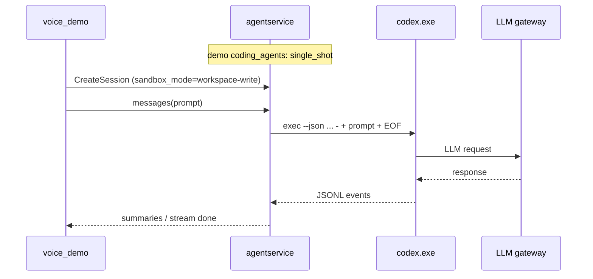

# 007: demo Codex の single_shot 化と voice_demo の書き込み sandbox

## 背景 (Background)

### なぜ必要か

調査 `tmp/investigations/018-Voice-Demo-Codex-Turn-Hang-No-Progress.md`（番号 018）で、voice_demo から Tern/Codex へ送った turn が `Turn started (messages)` のまま進まない原因が分かった。

1. `settings/demo/model_profiles.yaml` に `coding_agents` が無い。
2. 未設定時の既定 `execution_mode` は `interactive` である。
3. `interactive` では初回プロンプトを stdin に書いたあと **EOF を送らない**。
4. 起動は `codex exec ... -`（stdin から指示を読む）のため、Codex がプロンプト確定待ちで止まり、LLM gateway に接続しない。
5. これは interrupt 故障ではない（当該 turn は通常の `messages`）。

あわせて voice_demo の `CreateSession` は `sandbox_mode` を付けないため既定 `read-only` となり、ファイル作成系のデモ指示が書けない。work_dir が Temp 配下だと Codex が helper binaries を拒否する問題も、運用上まだ起きやすい。

### 現状の課題

| 観点 | 現状 |
| :--- | :--- |
| demo `coding_agents` | 未定義 → interactive 既定 |
| example 設定 | `execution_mode: single_shot` 明示 |
| voice_demo sandbox | 未指定 → read-only |
| voice_demo work_dir | 未指定時は `MkdirTemp`（Temp 配下） |
| 製品 interactive + `codex exec -` の契約 | 未解決（本仕様の対象外） |

### スコープ

| 対象 | 内容 |
| :--- | :--- |
| 対象 | demo の `model_profiles.yaml` に `coding_agents`（single_shot）を追加 |
| 対象 | voice_demo が `sandbox_mode=workspace-write` で CreateSession する |
| 対象 | README / ヒントで Tern demo 再起動・非 Temp work_dir・single_shot を明示 |
| 対象 | 上記を機械検証するテスト |
| 非対象 | interactive モード本体と `codex exec -` の製品整合（別仕様） |
| 非対象 | Realtime / ルーティング / 橋渡し（仕様 006）の再設計 |

### 仮の決定

* `backlog:97185caa-3881-4f78-96eb-20f34f6cc5de` — demo の Codex（と claudecode）は当面 `single_shot`
* `backlog:1cc42105-8345-452d-b3ad-580416807d2f` — voice_demo は `workspace-write`

---

## 要件 (Requirements)

### 必須要件 (Must)

#### M1. demo 設定に coding_agents を定義する

`settings/demo/model_profiles.yaml` に、example と同等のブロックを追加する。

```yaml
coding_agents:
  codex:
    max_prompt_bytes: 1048576
    max_execution_seconds: 3600
    idle_timeout_seconds: 300
    execution_mode: single_shot
  claudecode:
    max_execution_seconds: 3600
    idle_timeout_seconds: 300
    execution_mode: single_shot
```

Tern を demo 設定で起動したとき、Codex セッションの実行モードが `single_shot` であること（初回プロンプト後に stdin EOF）。

#### M2. voice_demo が workspace-write でセッションを作る

`features/voice_demo` の `CreateSession`（`cawa.go`）で `SandboxMode` に workspace-write 相当の定数（`client/v1` の既存値）を設定する。省略による read-only 既定に依存しない。

#### M3. 非 Temp work_dir の案内を明文化する

README に次を書く。

* demo Tern は本変更後に **再起動が必要**（設定再読込）。
* `TERN_WORK_DIR` は `AppData\\Local\\Temp` 配下を避け、リポジトリ内の書き込み可能パス（例: `tmp/voice-demo-work`）を推奨する。
* 既定エージェント例はデモで使う実エージェントに合わせてもよいが、wayfinder / codex のどちらでも動く前提を崩さない。

#### M4. 自動検証

* demo の YAML を読み（または文字列検査し）、`coding_agents.codex.execution_mode == single_shot`（claudecode も）を検証するテスト。
* voice_demo の CreateSession リクエストに `sandbox_mode` が workspace-write で載ることを単体試験する（httptest または既存の utterance/session 試験の拡張）。
* 既存 `features/voice_demo` 単体と `TestTurnInterrupt_` を壊さない。

### 任意要件 (Should)

#### S1. UI ヒント

`index.html` の hint に、Tern demo の single_shot / work_dir 注意を短く足す（詳細は README）。

#### S2. 既定 work_dir の改善（任意）

可能なら voice_demo の Temp 既定をやめ、リポジトリ相対の安定パスや必須 `TERN_WORK_DIR` にする。複雑なら README 必須化のみでよい（M3）。

### やらないこと (Won't)

* `interactive` で `codex exec -` が動くように process.go を改めること（別仕様）。
* Tern 本体の default を global で single_shot に戻すこと（demo に限定）。

---

## 実現方針 (Implementation Approach)

1. **設定**: `settings/demo/model_profiles.yaml` へ `coding_agents` を追記（example を正とする）。
2. **voice_demo**: `v1.SessionRequest{..., SandboxMode: v1.SandboxModeWorkspaceWrite}`（定数名はコード上の既存識別子に合わせる）。
3. **試験**:
   * 設定読込試験（`config` パッケージの既存 Load があればそれを使い、無ければ demo YAML の内容アサーションを適切なパッケージに置く）。
   * CreateSession body の `sandbox_mode` 検証。
4. **文書**: README / hint。



---

## 検証シナリオ (Verification Scenarios)

1. demo 設定で Tern を再起動する。`settings/demo/model_profiles.yaml` に `execution_mode: single_shot` があることを確認する。
2. `TERN_WORK_DIR` をリポジトリ内の非 Temp パスにし、`TERN_AGENT=codex` で voice_demo を起動する。
3. Start call のあと「ファイルの一覧がみたいです。」相当を CAWA に送る（auto で skip される場合は route=always または Send last line / long-task）。
4. **合格**: 数十秒以内に Tern ログに Codex stdout 相当の進捗、または CAWA summary が `Turn started` から更新される。gateway への接続が観測できる。End call まで `busy` のまま無更新、ではない。
5. 書き込み指示（小さなファイル作成）では、`workspace-write` により work_dir 内への作成が拒否されないこと（read-only 時の失敗と対比できること）。

---

## テスト項目 (Testing for the Requirements)

### ビルド・全体検証

1. ビルド＋単体テスト:
   `scripts/process/build.sh`

2. voice_demo 単体（sandbox / 設定関連を含む）:
   `go test -C features/voice_demo -count=1 ./...`

3. Turn interrupt リグレッション:
   `scripts/process/integration_test.sh --specify 'TestTurnInterrupt_'`

### 要件との対応

| 要件 | 検証 |
| :--- | :--- |
| M1 | demo YAML / config 読込テストで `single_shot` |
| M2 | CreateSession body の `sandbox_mode` 単体試験 |
| M3 | README 文言の静的検査（任意）またはレビュー＋手動シナリオ |
| M4 | 上記ビルド＋`TestTurnInterrupt_` |
| シナリオ 1–4 | 再現手順レポートで手動/半自動確認 |

---

## 参考

* 調査: `tmp/investigations/018-Voice-Demo-Codex-Turn-Hang-No-Progress.md`（gitignore。番号と題名で参照）
* example: `settings/example/model_profiles.yaml` の `coding_agents`
* 関連: `prompts/phases/000-foundation/branches/fix-codex-stdin-blocking/ideas/003-interactive-agent-user-input.md`
