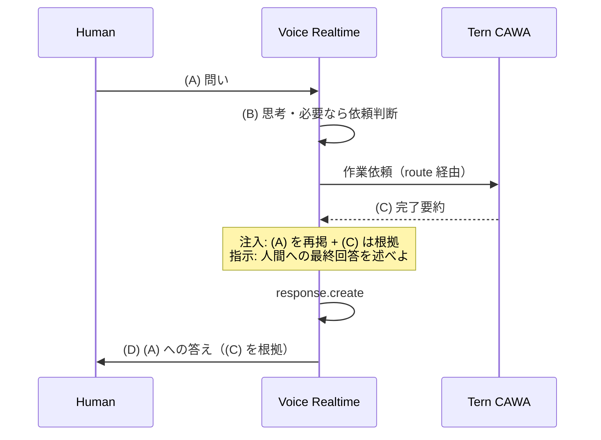

# 008: Tern Turn 完了後の Voice 発話を人間の問い (A) への回答として組み立てる

## 背景 (Background)

### なぜ必要か

`features/voice_demo` では OpenAI Realtime（Voice）と Tern CAWA（Coding Agent）を二層に分けている。CAWA の Turn 完了を検知して Realtime に `response.create` すると、Voice は必ず話し始めるが、その内容が **人間の問いから乖離** することが分かった。

ユーザーが報告した構造:

```text
人間: 問いかけ (A)
  → Voice: 思考・調査・依頼判断 (B)
  → Tern: 作業
  → Tern: 作業完了結果 (C)
  → Voice: (C) に対する返事 (D)   ← ここが問題
  → 人間: (A) と噛み合わない (D) を聞かされる
```

例:

* (A)「トップフォルダにある README を要約して」
* (B) Voice が ls や README 閲覧を判断し、必要なら Tern に依頼
* (C) Tern が「README を要約すると XXX です」と結論
* (D) 現状の聞こえ方: 「結果が返ってきました。要約すると XXX だということですね。わかりました。」

人間が期待するのは **(A) への直接の答え**（例: 「README の要約は XXX です」）である。ところが現状の (D) は、注入された Tern 状況メモ (C) を **別ユーザー発話として受け取り、そのメタ確認** をしている。会話の軸が (A) から (C) へすり替わる。

### 現状の課題

| 観点 | 現状 |
| :--- | :--- |
| Turn 完了検知 | busy→idle で橋渡し＋`response.create`（実験的実装あり） |
| 注入文 | `Tern coding agent status: …` 形式の状況メモ |
| Realtime instructions | Tern 状況メモを ground truth として扱え、とあるが「(A) に答えよ」は無い |
| 発話 (D) の役割 | モデルが (C) への Ack／言い直しになりやすい |
| 仕様 006 M5 | 注入後の自動 `response.create` は禁止だった（完了発話の要否は未整理） |

### スコープ

| 対象 | 内容 |
| :--- | :--- |
| 対象 | Turn 完了時に Voice が発話する場合の **発話の根拠と役割**（(A) への回答） |
| 対象 | 橋渡し注入文・Realtime instructions・必要なら UI ラベルの改訂 |
| 対象 | 途中進捗は無発話のまま（完了時のみ発話対象） |
| 非対象 | 本番 Voice Mediator の単一コンテキスト設計 |
| 非対象 | Tern 内部の作業品質そのもの（(C) の正しさ） |
| 非対象 | auto ルーティングのキーワード拡充（別件） |

### 仮の決定

* `backlog:4e2f92d0-97ee-43c1-8e9a-9a846365481f` — Turn 完了時の Voice 発話は問い (A) への回答として組み立てる

関連:

* 仕様 006（橋渡し・ルーティング）: [006-Voice-Demo-Voice-Speed-And-Context-Bridge.md](prompts/phases/001-phase02/branches/feat-turn-interrupt-resume/ideas/006-Voice-Demo-Voice-Speed-And-Context-Bridge.md)
* 調査 017 / 018（飢餓・stdin 等）は本仕様の直接対象外

---

## 要件 (Requirements)

### 必須要件 (Must)

#### M1. 会話ロールの定義を固定する

デモおよび実装コメント／instructions で、次の記号を一貫して使う。

| 記号 | 意味 | 所有者 |
| :--- | :--- | :--- |
| (A) | 人間の最新の問い・依頼 | 人間 |
| (B) | Voice の思考・調査・Tern 依頼判断 | Realtime（会話層） |
| (C) | Tern Coding Agent の作業完了結果（短い結論・要約） | CAWA（実行層） |
| (D) | Voice が人間に向けて発話する内容 | Realtime |

**不変条件**: (D) は (A) への回答でなければならない。(C) は (D) を組み立てる **根拠** であり、(D) の会話相手ではない。

#### M2. Turn 完了時の発話は (A) を主語にする

CAWA が busy→idle になり Voice が発話する場合:

1. (C) を Realtime 会話に渡す。
2. 渡す文言は「状況報告として聞け」ではなく、**「人間の問い (A) に答えるための材料。最終発話は (A) への答えにせよ」** と明示する。
3. そのうえで `response.create` してよい（006 M5 の「注入後に自動 create しない」は、**完了発話を行う場合に限り本仕様で上書き**する）。
4. (D) に次を含めてはならない（禁止フレーズの例）:
   * 「結果が返ってきました」
   * 「〜だということですね。わかりました」
   * Tern／エージェントへの Ack や復唱確認だけ

#### M3. (A) の保持

Voice／デモは、CAWA に依頼した時点の人間発話 (A)（または「いま答えようとしている問い」）を保持し、完了橋渡しに紐づける。

* 最低限: 直近のユーザー確定発話テキストを保持する（既存 `lastYouLine` 等で可）。
* 完了注入時に (A) を再掲する（モデルが (C) だけを見てメタ返事しないようにする）。

#### M4. 途中進捗は無発話

Turn 実行中の進捗要約（tool 実行中など）を橋渡ししても、**自動 `response.create` してはならない**。発話トリガは busy→idle（完了）に限定する。

#### M5. Realtime instructions の更新

session 作成時の instructions に次を含める。

* Coding Agent の完了メモは、人間の直前の問いに答えるための材料である。
* 完了メモを受け取って発話するときは、人間に向けて結論を述べる。状況受領のメタ発話をしない。
* 二層分離は維持する（Voice が実行権威にならない）。

#### M6. 自動検証

* AppJS／静的契約: 完了時のみ `response.create`、注入文に (A) 再掲または「answer the user's question」相当の指示が含まれること。
* instructions 文字列に M5 の禁止メタ発話／回答義務が含まれること（`realtime.go` または生成箇所の試験）。
* 既存 barge-in／resume／route／voices 契約を壊さないこと。

### 任意要件 (Should)

#### S1. エラー完了時も (A) に紐づける

(C) がエラー要約のときも、「結果が返ってきた」ではなく、人間向けに「README の要約はまだ取れません。理由は …」のように (A) を意識した失敗報告にする。

#### S2. UI ヒント

hint に「Turn 完了後の Voice は、Tern への返事ではなく、あなたの問いへの答えを話す」と短く書く。

### やらないこと (Won't)

* Realtime と CAWA を単一セッションに統合すること
* (C) の全文ログを読み上げること（短い結論に限る）
* 完了以外の毎回の status ポーリングで発話すること

---

## 実現方針 (Implementation Approach)

### 目標フロー



### 注入文の形（仮）

完了時のみ、例えば次の構造にする（文言は実装で英日どちらでもよいが意味は固定）:

```text
User question to answer (do not acknowledge the coding agent; answer the human):
<A>

Coding agent result (use as evidence only):
<C>

Speak the final answer to the human now.
```

状況専用プレフィックス `Tern coding agent status:` **だけ**を渡して `response.create` するのは、本仕様では不十分とする（メタ返事 (D) を誘発するため）。

### 変更見込み箇所

* `features/voice_demo/static/app.js` — 完了時注入文に (A) 再掲＋回答指示、途中は speak しない
* `features/voice_demo/realtime.go` — instructions を M5 に合わせて更新
* `features/voice_demo/context_bridge.go` — 必要なら完了用ノート生成をサーバ側に寄せる
* 試験: AppJS 契約、instructions 文字列、（任意）bridge note 生成

### 006 との関係

* 006 M5「注入後に自動 create しない」は、**進捗注入**については維持する。
* **Turn 完了発話**については本仕様が優先し、create してよいが (D) の役割を M1–M2 で拘束する。

---

## 検証シナリオ (Verification Scenarios)

ユーザー提示の粒度をそのまま用いる。

1. Start call し、Context bridge を on にする。
2. 人間が (A)「トップフォルダにある README を要約して」と言う（または同等テキストを CAWA に送る）。
3. Voice が (B) として判断し、必要なら Tern に作業が渡る。
4. Tern が作業し (C) として README 要約相当の結論を出す。
5. **合格**: Voice の発話 (D) は、人間に向けた要約そのもの（例: 「README の要点は …」）であり、「結果が返ってきました」「〜だということですね。わかりました」のような (C) へのメタ返事ではない。
6. **不合格例**: (D) が Tern／状況メモへの Ack になっており、(A) への答えとして聞こえない。
7. Turn 実行中の進捗要約だけでは Voice が自動発話しないこと。
8. エラーで Turn が終わった場合、(D) は (A) に紐づく失敗説明であり、状況受領のメタ発話だけではないこと（S1）。

---

## テスト項目 (Testing for the Requirements)

### ビルド・全体検証

1. ビルド＋単体テスト:
   `scripts/process/build.sh`

2. voice_demo 単体（橋渡し・instructions・AppJS）:
   `go test -C features/voice_demo -count=1 ./...`

3. Turn interrupt リグレッション:
   `scripts/process/integration_test.sh --specify 'TestTurnInterrupt_'`

### 要件との対応

| 要件 | 検証 |
| :--- | :--- |
| M1–M3 | 注入文生成の単体／AppJS 契約（(A) 再掲・answer 指示・禁止メタの不使用） |
| M4 | AppJS: speak が busy→idle のみ |
| M5 | `realtime.go` instructions 文字列試験 |
| M6 | 上記＋既存契約試験 |
| シナリオ 1–8 | 再現手順レポート（手動耳確認）。自動は契約試験で代用可能な範囲を先に固める |

---

## 参考

* 現行の完了発話実験: `features/voice_demo/static/app.js` の `requestRealtimeSpeak` / `turnJustFinished`
* 006 M5 橋渡し: 注入後 create 禁止（本仕様で完了時のみ緩和＋役割拘束）
