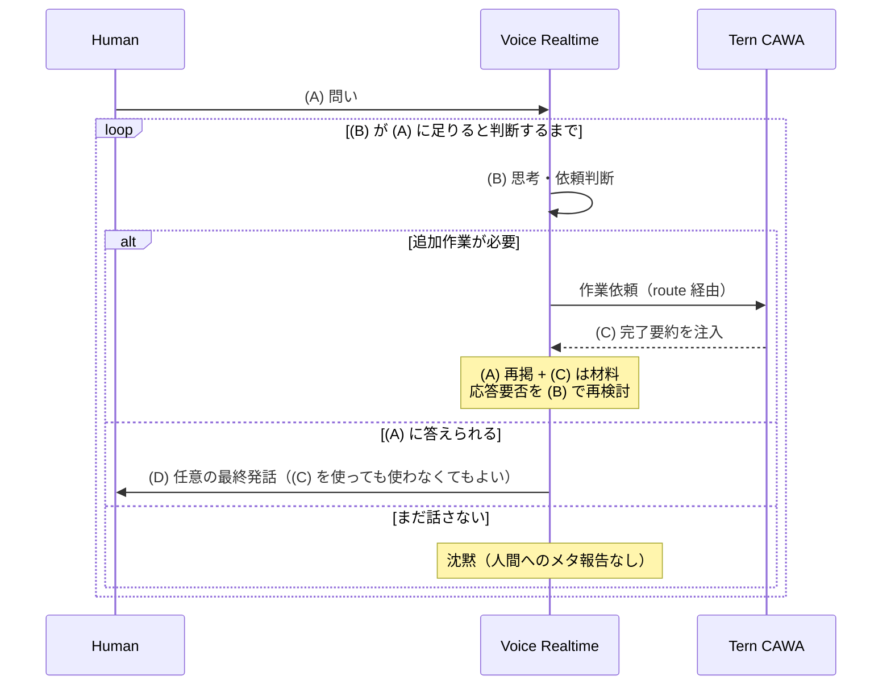

# 008: Tern Turn 完了後は (B) で再検討し、(D) は問い (A) への任意の最終発話とする

## 背景 (Background)

### なぜ必要か

`features/voice_demo` では OpenAI Realtime（Voice）と Tern CAWA（Coding Agent）を二層に分けている。CAWA の Turn 完了を検知して Realtime に即 `response.create` すると、Voice は必ず話し始めるが、その内容が **人間の問いから乖離** することが分かった。

ユーザーが報告した構造:

```text
人間: 問いかけ (A)
  → Voice: 思考・調査・依頼判断 (B)
  → Tern: 作業
  → Tern: 作業完了結果 (C)
  → Voice: (C) に対する返事 (D)   ← ここが問題
  → 人間: (A) と噛み合わない (D) を聞かされる
```

例:

* (A)「トップフォルダにある README を要約して」
* (B) Voice が ls や README 閲覧を判断し、必要なら Tern に依頼
* (C) Tern が「README を要約すると XXX です」と結論
* (D) 現状の聞こえ方: 「結果が返ってきました。要約すると XXX だということですね。わかりました。」

人間が期待するのは **(A) への直接の答え**（例: 「README の要約は XXX です」）である。ところが現状の (D) は、注入された Tern 状況メモ (C) を **別ユーザー発話として受け取り、そのメタ確認** をしている。会話の軸が (A) から (C) へすり替わる。

### レビューで追加された論点

場合によっては:

* (C) の内容を (A) の回答に **入れる必要はない**（根拠の一部にすぎない、または不要）。
* (C) だけでは (A) に足りなければ、(B) を **再度検討** し、追加の Tern 依頼や別手段が必要になる。
* したがって Turn 完了のたびに Voice が **即座に発話する** より、(B) で「いま人間に話すか／まだ作業を続けるか／黙るか」を検討し、その結果として (D) を出す（または出さない）方が自然である。
* (B)→Tern→(C)→(B)… の **ターン循環** を許す。

### 現状の課題

| 観点 | 現状 |
| :--- | :--- |
| Turn 完了検知 | busy→idle で橋渡し＋即 `response.create`（実験的実装あり） |
| 注入文 | `Tern coding agent status: …` 形式の状況メモ |
| Realtime instructions | Tern 状況メモを ground truth として扱え、とあるが「(A) に答えよ／足りなければ再検討」は無い |
| 発話 (D) の役割 | モデルが (C) への Ack／言い直しになりやすい |
| 完了＝発話 | 完了のたびに話す前提になっており、(B) の再検討ループが無い |
| 仕様 006 M5 | 注入後の自動 `response.create` は禁止だった（完了時の扱いが未整理） |

### スコープ

| 対象 | 内容 |
| :--- | :--- |
| 対象 | Turn 完了後の **(B) 再検討**（応答要否・追加依頼・沈黙）と、発話する場合の (D) の役割 |
| 対象 | 橋渡し注入文・Realtime instructions・必要なら UI ラベルの改訂 |
| 対象 | 途中進捗は無発話のまま |
| 非対象 | 本番 Voice Mediator の単一コンテキスト設計 |
| 非対象 | Tern 内部の作業品質そのもの（(C) の正しさ） |
| 非対象 | auto ルーティングのキーワード拡充（別件） |

### 仮の決定

* `backlog:4e2f92d0-97ee-43c1-8e9a-9a846365481f` — Turn 完了後は即発話せず (B) で再検討し、(D) は (A) への任意の最終発話とする

関連:

* 仕様 006（橋渡し・ルーティング）: [006-Voice-Demo-Voice-Speed-And-Context-Bridge.md](006-Voice-Demo-Voice-Speed-And-Context-Bridge.md)
* 調査 017 / 018（飢餓・stdin 等）は本仕様の直接対象外

---

## 要件 (Requirements)

### 必須要件 (Must)

#### M1. 会話ロールの定義を固定する

デモおよび実装コメント／instructions で、次の記号を一貫して使う。

| 記号 | 意味 | 所有者 |
| :--- | :--- | :--- |
| (A) | 人間の最新の問い・依頼 | 人間 |
| (B) | Voice の思考・調査・Tern 依頼判断・**応答要否の判断** | Realtime（会話層） |
| (C) | Tern Coding Agent の作業完了結果（短い結論・要約） | CAWA（実行層） |
| (D) | Voice が人間に向けて発話する内容（**発話する場合のみ**） | Realtime |

**不変条件**:

1. (C) は (B) が使う **材料** であり、会話の相手ではない。
2. (D) を出す場合、それは (A) への回答でなければならない（(C) へのメタ Ack ではない）。
3. (C) の文言を (D) に含めることは **必須ではない**。(B) が (A) に足りると判断した範囲だけを使ってよい。
4. (C) が (A) に不足なら、(B) は追加の Tern 依頼や別手段を選んでよく、その間 (D) は出さなくてよい。

#### M2. Turn 完了時は即発話せず (B) を回す

CAWA が busy→idle になったとき:

1. (C) を Realtime 会話に渡す（橋渡し）。
2. 渡す文言は「状況報告として聞け／今すぐ答えよ」ではなく、**「(A) を再掲したうえで、(C) は材料。足りるか・人間に話すか・追加依頼するかを (B) として検討せよ」** と明示する。
3. その後 Realtime 側で (B) 相当の検討ターンを走らせてよい（`response.create` を含む場合でも、指示は「必ず読め上げ」ではなく「検討結果に従う」）。
4. (B) の結果として許されるアウトカム:
   * **(D) を発話**: (A) への最終回答（(C) を使っても使わなくてもよい）
   * **沈黙**: まだ人間に話す段階ではない（追加作業中・判断保留）
   * **追加の Tern 依頼**: route／utterance 経由で次の作業を依頼し、(B)→Tern→(C)→(B) を続ける
5. (D) に次を含めてはならない（禁止フレーズの例）:
   * 「結果が返ってきました」
   * 「〜だということですね。わかりました」
   * Tern／エージェントへの Ack や復唱確認だけ

#### M3. (A) の保持

Voice／デモは、いま答えようとしている人間発話 (A) を保持し、完了橋渡しと (B) 再検討に紐づける。

* 最低限: 直近のユーザー確定発話テキストを保持する（既存 `lastYouLine` 等で可）。
* 完了注入時に (A) を再掲する（モデルが (C) だけを見てメタ返事・即読上げしないようにする）。
* 追加 Tern 依頼のあいだも (A) は同じ問いのまま保持する（人間が新しい問いを出すまで）。

#### M4. 途中進捗は無発話・無再検討トリガ

Turn 実行中の進捗要約を橋渡ししても、**自動 `response.create` してはならない**。(B) 再検討のトリガは busy→idle（完了）に限定する。

#### M5. Realtime instructions の更新

session 作成時の instructions に次を含める。

* Coding Agent の完了メモ (C) は、人間の問い (A) に答えるための材料であり、会話相手ではない。
* (C) を受け取ったら、まず (B) として「(A) に足りるか／人間に話すか／追加依頼するか」を検討する。不足なら追加依頼してよく、そのとき人間へのメタ報告は不要。
* 人間に話すときだけ (D) とし、内容は (A) への答えにする。(C) の復唱や状況受領の Ack をしない。
* 二層分離は維持する（Voice が実行権威にならない。追加作業は既存の utterance／route 経路で CAWA に渡す）。

#### M6. 自動検証

* AppJS／静的契約: 進捗注入では `response.create` しない。完了時の注入文に (A) 再掲と「検討／応答要否／追加依頼可」相当が含まれ、「今すぐ読め上げ」強制だけにならないこと。
* instructions 文字列に M5（再検討・(C) は材料・メタ Ack 禁止）が含まれること。
* 既存 barge-in／resume／route／voices 契約を壊さないこと。

### 任意要件 (Should)

#### S1. エラー完了時も (B) 経由

(C) がエラー要約のときも即メタ発話せず、(B) で「人間に失敗を伝えるか／別手段で再依頼するか」を選ぶ。伝える場合は (A) に紐づく失敗説明にする。

#### S2. UI ヒント

hint に「Turn 完了後も Voice はすぐ話さず、あなたの問いに足りるか考えてから答える（足りなければ Tern に続ける）」と短く書く。

#### S3. 沈黙時の UI

(B) が沈黙を選んだとき、ログに `bridge> reconsider (no speak)` 等を出し、人間向けステータスが「固まった」ように見えないようにする。

### やらないこと (Won't)

* Realtime と CAWA を単一セッションに統合すること
* (C) の全文ログを読み上げること（短い結論に限る）
* 完了以外の毎回の status ポーリングで発話・再検討すること
* (C) を必ず (D) に含めること

---

## 実現方針 (Implementation Approach)

### 目標フロー（循環あり）



### 注入文の形（仮）

完了時のみ、例えば次の構造にする（文言は実装で英日どちらでもよいが意味は固定）:

```text
Open question from the human (still unanswered until you decide otherwise):
<A>

Coding agent result (optional evidence; you may ignore details irrelevant to A):
<C>

Reconsider (B): Does this suffice to answer A?
- If yes and you should speak to the human: say D as the answer to A (not an ack to the agent).
- If not enough: request more work via the usual coding-agent path; do not narrate status to the human.
- If you should stay silent for now: say nothing.
Do not say that results came back or that you understood the agent.
```

状況専用プレフィックス `Tern coding agent status:` **だけ**を渡して即 `response.create`（読め上げ強制）するのは、本仕様では不適切とする。

### 完了時の `response.create` の扱い（仮）

* **方針**: 完了注入のあと、(B) 再検討のために Realtime の応答ターンを 1 回走らせてよい。ただし指示は「必ず声に出せ」ではなく、沈黙・追加依頼・(D) の選択を許す。
* Realtime が「無音の response」を扱いづらい場合は、テキストのみの内部検討＋必要なときだけ音声、または function call／client 側での追加 utterance 送信など、実装計画で具体化する。
* 006 M5「注入後に自動 create しない」は **進捗注入** では維持。完了時は本仕様の「再検討ターン」として緩和するが、**即読上げ強制は禁止**。

### 変更見込み箇所

* `features/voice_demo/static/app.js` — 完了時注入文を再検討フレーミングに変更。即読上げ前提の `requestRealtimeSpeak` 文言／呼び出し方針を見直す
* `features/voice_demo/realtime.go` — instructions を M5 に合わせて更新
* `features/voice_demo/context_bridge.go` — 必要なら完了用ノート生成をサーバ側に寄せる
* 試験: AppJS 契約、instructions 文字列、（任意）bridge note 生成

### 006 との関係

* 006 M5 の進捗無発話は維持。
* 完了時は本仕様が優先: create してよいのは **(B) 再検討**のためであり、(D) 強制のためではない。

---

## 検証シナリオ (Verification Scenarios)

ユーザー提示およびレビュー指摘の粒度を残す。

1. Start call し、Context bridge を on にする。
2. 人間が (A)「トップフォルダにある README を要約して」と言う（または同等テキストを CAWA に送る）。
3. Voice が (B) として判断し、必要なら Tern に作業が渡る。
4. Tern が作業し (C) として README 要約相当の結論を出す。
5. **合格（十分な (C)）**: Voice が発話するなら (D) は人間向けの要約そのもの（例: 「README の要点は …」）。「結果が返ってきました」「〜だということですね。わかりました」のような (C) へのメタ返事ではない。
6. **合格（(C) を使わない／一部だけ使う）**: (B) が (A) に不要と判断した (C) の細部を (D) に含めない。または既に (B) 側で足りるなら (C) を読上げない。
7. **合格（不足時の再検討）**: (C) が (A) に足りない場合、Voice はメタ状況報告の代わりに追加の Tern 依頼へ進むか沈黙し、後続の (C') のあとで改めて (B) する。ターンが (B)→Tern→(C)→(B) と回る。
8. **不合格例**: Turn 完了のたびに必ず声が出て、内容が Tern／状況メモへの Ack になっている。
9. Turn 実行中の進捗要約だけでは Voice が自動発話しないこと。
10. エラーで Turn が終わった場合も即メタ発話せず、(B) 経由で (A) に紐づく失敗説明または再依頼になること（S1）。

---

## テスト項目 (Testing for the Requirements)

### ビルド・全体検証

1. ビルド＋単体テスト:
   `scripts/process/build.sh`

2. voice_demo 単体（橋渡し・instructions・AppJS）:
   `go test -C features/voice_demo -count=1 ./...`

3. Turn interrupt リグレッション:
   `scripts/process/integration_test.sh --specify 'TestTurnInterrupt_'`

### 要件との対応

| 要件 | 検証 |
| :--- | :--- |
| M1–M3 | 注入文生成の単体／AppJS 契約（(A) 再掲・再検討指示・即読上げ強制の不使用・禁止メタ） |
| M4 | AppJS: 進捗では speak／再検討トリガなし |
| M5 | `realtime.go` instructions 文字列試験 |
| M6 | 上記＋既存契約試験 |
| シナリオ 1–10 | 再現手順レポート（手動耳確認）。自動は契約試験で代用可能な範囲を先に固める |

---

## 参考

* 現行の完了発話実験: `features/voice_demo/static/app.js` の `requestRealtimeSpeak` / `turnJustFinished`（本仕様で「即読上げ」前提を見直す）
* 006 M5 橋渡し: 注入後 create 禁止（本仕様は完了時の再検討ターンに限り緩和し、読上げ強制は禁止）
